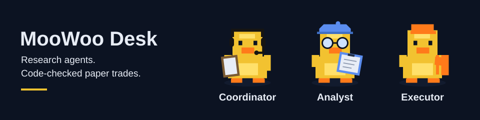
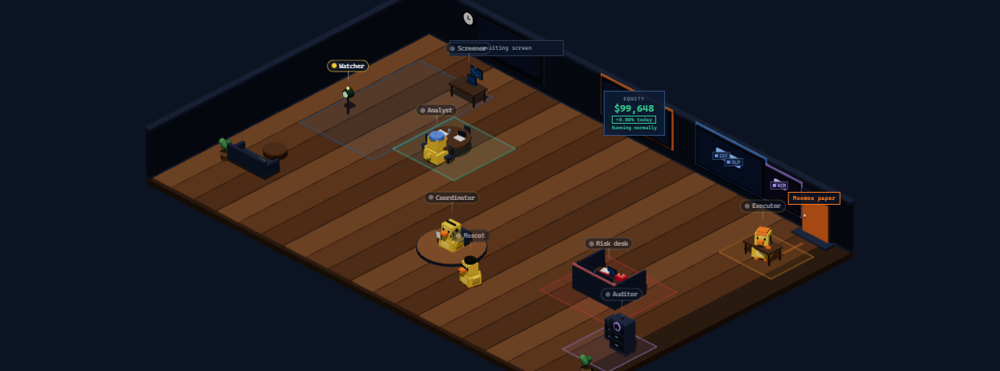
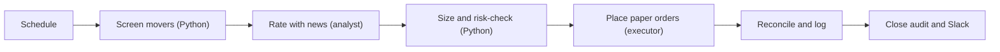

<h1 align="center">MooWoo Desk</h1>

<p align="center"></p>

<p align="center">
  
  <a href="LICENSE"></a>
  
  
</p>

<p align="center">
  <b>A paper-trading experiment with research agents and code-enforced risk limits.</b><br>
  Moomoo x Qoder AI Paper Trading Agent Challenge<br>
  <a href="https://moowoo-desk-p36f61ggjia.qoder.website">Live dashboard</a> &middot;
  <a href="PREREGISTRATION.md">Pre-registration</a> &middot;
  <a href="docs/">Documentation</a>
</p>

---

MooWoo Desk is a paper-trading desk built for the Moomoo x Qoder AI Paper Trading Agent Challenge. Qoder Cloud Agents research unusual US stock moves, coordinate scheduled runs and forward approved paper orders through Moomoo MCP. Python, not the language model, selects candidates, sizes positions, applies risk limits, checks each dispatch and reconciles fills. A private, hash-chained event log records the decisions; a scrubbed feed powers the public dashboard. The experiment asks whether a news-aware rating adds value over simple follow-the-move and fade-the-move rules. It does not claim an established trading edge.

Trading window: **17-27 November 2026**. Submission: **30 November 2026**.

**Result:** USD 101,942 at the 27 November close (+1.9%, SPY −1.4%), but the final sell-off failed, so most of it is unrealised. [Details](#results).

Judging weights: risk-adjusted return 25%, Qoder and Cloud Agent usage 30%,
strategy and risk design 30%, reusability and documentation 15%.

Live dashboard: **https://moowoo-desk-p36f61ggjia.qoder.website**, read-only,
built from the scrubbed public feed. It has no broker access and never loads the
private ledger.

## A paper session from signal to review

<!-- TODO screenshot: docs/images/dashboard-now.png, dashboard Now tab -->

<table>
  <tr>
    <td width="50%"><b>1 &middot; Research.</b><br>Python screens completed daily bars. The analyst rates at most five unusual moves using timely news and evidence.</td>
    <td width="50%"><b>2 &middot; Check.</b><br>Python validates ratings, sizes whole-share positions and applies risk limits before authorizing each dispatch.</td>
  </tr>
  <tr>
    <td><b>3 &middot; Reconcile.</b><br>The executor forwards exact approved paper-order arguments. Broker receipts become positions only after fill reconciliation.</td>
    <td><b>4 &middot; Review.</b><br>The scrubbed dashboard shows session events. The separate auditor grades calls and delivers the code-written close summary through its Slack schedule sink.</td>
  </tr>
</table>

### Trading floor

<p align="center"></p>

The dashboard's **Floor** tab replays one loaded session as a small voxel office.
Three ducks represent the active agents (coordinator, analyst, executor); screener,
risk desk, watcher and auditor are code stations with no duck. Stations light from
the event log, a halt raises an alarm, and replay offers play/pause, speed, a
scrubber, event stepping and a session picker. The floor is a visualisation of the
same scrubbed feed as the rest of the dashboard, not a separate order engine or a
live broker view.

At desktop widths with WebGL the floor renders in 3D; on phone widths under 640
pixels, without WebGL, or with `prefers-reduced-motion`, it falls back to a static
2D map with the same event lighting. The stage reserves the bottom-right area for
the host badge instead of placing controls there.

## The question behind the desk

> **Does news explain an unusual stock move well enough to guide a paper trade?**
> The experiment compares news-aware ratings with follow-the-move and fade-the-move rules. Calls, vetoes and evidence gaps stay in the record; the result is not assumed in advance.

## How it works

Three trading agents share the desk; Python screens candidates, sizes positions
and enforces risk limits. Watch sessions manage existing positions without new
rating calls, and positions change only after fills are reconciled.

| Coordinator | Analyst | Executor |
| :---: | :---: | :---: |
|  |  |  |
| Runs the schedule and phases. | Rates moves and fetches quotes. | Forwards only code-approved paper orders. |

The separate auditor checks the close and posts to Slack, with no order tools.



See the [detailed session flow](docs/runtime.md#detailed-session-flow) for the full runtime path.

## Strategy in plain words

**Allocation: core 30% + SPY 30% + satellites, with a 10% cash floor.**

**SPY sleeve: always-held 30% target, subject to available cash and risk limits.** SLEEVE-01 invests idle
cash after core sells, core buys and satellite entries. SPY buys use cash above
the 10% floor after all pending buys and fees; no projected sale proceeds.
SPY uses the core's 25% relative rebalance band, has no stop, trailing stop or
horizon exit, and is never sold to fund satellite entries. Account loss limits,
kill liquidation and final-day entry restrictions apply as for core ETFs.
Satellite caps remain 60% overall, 40% in a weak regime and 20% per name;
held SPY naturally reduces cash available to satellites.

**Core: 30% target across five ETFs.** USMV, XLP, XLV, IEF and GLD form the core.
Weights are inverse to each ETF's daily-return volatility over 60 sessions, not
equal weights. Rebalancing starts when a holding deviates by at least 25% of its
target weight. Planned sells inform buy sizing. Dispatch permits cash-funded
buys when the 10% floor holds and core exposure fits 30% plus the current value
of planned, unfilled core sells. If those sells never fill, temporary overweight
is accepted until the next morning rebalance. Buys needing sale proceeds still
wait for full reconciled core sells.

**Satellite: up to 60% in explained-move trades.** The screener uses completed
daily bars and the frozen stock universe. It finds moves at least two standard
deviations from the stock's SPY-adjusted history over 60 sessions. It ranks
earnings-related candidates first, then abnormal-move size times relative volume
(volume contribution capped at three), and takes at most five.

For each candidate, the analyst asks whether timely news explains the move and
returns a four-way class, confidence, evidence and an invalidation condition:

| Class | Candidate action |
| --- | --- |
| 🟩 `explained_up` | Consider a continuation trade, with relative volume at least two |
| 🟨 `unexplained_down` | Consider a bounce, only above EMA20 or near support, with relative volume below three |
| 🟥 `explained_down` | No long entry |
| 🟥 `unexplained_up` | No long entry |

Sizing starts at 20% of equity times confidence times
`min(1, 0.02 / daily_return_sd)`, then applies account-tier reductions and risk
limits. It uses whole shares. Confidence is an input to sizing, not evidence that
the model is calibrated. The price-action setup score is logged only and never
changes size.

The core, normal satellite and per-name settings come from **SIZING-01**
(Addendum 22). Addendum 27 adds **SIZING-02**, **CORE-REBALANCE-02** and
**SLEEVE-01**, effective during the 19 November New York session. These changes
deliberately depart from the original core, satellite, per-name and spread settings and from
the original no-loosening commitment. The original freeze remains intact; the
rule ledger records the change. Both normal and step-up satellite caps are now
60%, so reaching the historical step-up threshold does not increase that ceiling.
The matched-book invalidation check still applies after 15 closed satellite trades.

## Risk limits

Current source: [configuration](moowoo/config.py), [risk checks](moowoo/risk.py),
[pre-registration and addenda](PREREGISTRATION.md), and
[authorized rule changes](config/rule-ledger.jsonl). Earlier documentation may
quote superseded values; use these sources together, not the original freeze alone.

| Control | Current rule |
| --- | --- |
| Account and direction | Paper account only, eligible US stocks and ETFs, long only; no naked sells |
| Allocation | Core target 30%; SPY target 30%; satellite cap 60%; minimum cash 10%, including pending commitments |
| Satellite concentration | At most 20% equity per name; at most three bounce names including pending entries |
| Daily loss | At 1.5% loss from session-start equity, block entries; protective exits remain available |
| Peak drawdown | At 2% loss, reduced sizing; at 4%, exits only; at 6%, kill tier cancels entries and liquidates |
| Market regime | SPY below EMA20 or SMA100, or short volatility at least twice long volatility: block new bounces and cap satellite at 40% |
| Entry liquidity | Spread at most 0.5% of midpoint; order notional at most 0.5% of prior 20-session average dollar volume |
| Correlation | At most 0.80 against existing and pending satellite names, using 60 daily returns |
| Quote age | At most 60 seconds, no future timestamps; check again before every dispatch |
| Order count and time | Entry gate at 30 orders per session; no orders in first five market minutes; runtime enforces open sessions |
| Minimum buy | $2,000 notional; exits have no minimum-notional requirement |
| Initial stop | Drift: three ATR below entry; bounce: two ATR; support minus one ATR can tighten either |
| Trailing stop | Arm at one signal ATR profit, trail by 1.5 ATR, never loosen |
| Holding period | Drift at most five sessions; bounce at most three, with pre-drop close as bounce target |
| Final day | No new entries on 27 November; mark at the early close; protective exits remain available |
| Modelled fees | $0.99 per filled order plus $0.000166 per share sold, sell component capped at $8.30 |

Risk checks return approve, resize or veto. A valid sell can bypass entry-only
gates, but not duplicate-decision checks, available-long-share limits, dispatch
authorization or the market calendar. These are scheduled checks, not a promise
of continuous broker-hosted stops or guaranteed exit prices.

## Schedules

Source: [deployment builder](scripts/qca_deploy.py) and [calendar](moowoo/calendar.py).
During this November window, Singapore is **13 hours ahead** of New York. This
offset is not a year-round scheduling rule. All cron expressions use New York time.

| Run | New York | Singapore |
| --- | --- | --- |
| Morning | Weekdays 09:35 | 22:35, same date |
| Regular watcher | 10:00-15:30, every 30 minutes | 23:00-04:30, crossing into the next date |
| Close watcher | 15:55 | 04:55, next date |
| Audit | 16:10 | 05:10, next date |
| Early-close watcher, 27 November | 12:55 | 01:55, 28 November |
| Early-close audit, 27 November | 13:10 | 02:10, 28 November |

The calendar skips 26 November (holiday), runs outside the trading window, and
late regular runs on the 27 November early close. That session closes at 13:00
New York, or 02:00 Singapore on 28 November. Six schedules share two templates
(coordinator and auditor) and one environment. An account-wide ledger lease
prevents overlapping writers across schedules. These are the builder's intended
schedules, not a fresh verification of the deployed resources.

## What changed during the experiment

| Addenda | Problem and correction |
| --- | --- |
| Addenda 9-12 | scheduling, clock access and file handoffs disagreed. The morning moved to 09:35 New York; the coordinator owns clock/files and uses the frozen calendar and explicit phase commands. |
| Addenda 13-16 | fifteen picks and lengthy multi-agent context were impractical. Selection fell to five, briefs went inline, failures gained a closed abort vocabulary and context was shortened. |
| Addenda 17-18 | batched calls, prose-wrapped ratings and missing model provenance broke ingestion. Calls became per ticker; strict JSON stayed mandatory; an explicitly null model can be filled from the analyst config. |
| Addendum 19 | thirteen attempts on 17 November yielded no orders and no accepted debate rating. One researcher-rater replaced bull/bear/manager/quick; quotes became per order. Debate-versus-quick evaluation claims no longer apply to the active path. |
| Addendum 20 | the cloud checked out stale code despite updated prompts. Revision and prompt-hash alignment became essential; quote replies were trimmed to reduce copying delay. |
| Addendum 21 | a small fresh-quote move rejected an otherwise marketable prepared limit. Dispatch now checks whether the saved limit is still marketable, without changing its price or identity. |
| Addenda 22-24 | allocation was too small for the revised experiment, position field names were wrong, asynchronous valuation caused false halts, and never-sent authorizations reserved cash. SIZING-01 records the deliberate rule deviation; parsers use real fields; valuation tolerance scales; releases require complete history and no-handoff/expiry evidence. |
| Addendum 25 | a copied history row lost quantity and stopped later runs; audits lacked bars; core buys could not follow sells; a close watcher fired after closing. Input errors now abort one run, audit bars and partial reports are supported, CORE-REBALANCE-01 requires fully reconciled sells before core buys, and close watchers run five minutes before closing. These are implemented corrections, not a claim that every revised cloud path has been observed live. |
| Addendum 26 | unreadable quote files share the existing one-refresh budget; a second failure skips the ticket. Code writes the close summary, delivered only by the auditor's Slack schedule sink. |
| Addendum 27 | SIZING-02 raises the weak-regime satellite cap to 40%; CORE-REBALANCE-02 permits cash-funded core buys before sells reconcile, with temporary core overweight limited to planned unfilled sells; SLEEVE-01 adds the always-held 30% SPY target. Cash and loss limits still apply. |
| Addenda 28-30 | organisers counted only realised results: FINAL-CLOSE-01 sells everything from 12:00 New York on 27 November with retries, and accepts exit quotes up to 300 seconds old; TICKER-CAP-01 caps each ticker at USD 40,000; LIMIT-01 adds a price cushion; the book follows the broker's diluted cost after a part-sale. |
| Addendum 31 | a part-filled sell looked like a mismatch and a closed zero-share row failed validation, stopping every run on 25 November. Part-filled orders now wait and closed rows are dropped; this worked live on 27 November. |
| Addendum 32 | the final sell-off never ran: the planning quote step kept a 60-second limit, so one stale USMV quote blocked all sells twice, and the last retry started after the close. Nine holdings stayed open. No trades after the window. |

## Run locally

Python 3.11+ is required. Use the existing environment when present. For a new
checkout, dependency installation needs package-index access unless packages are
already cached:

### 1. Prepare the environment

```powershell
python -m venv .venv
.venv\Scripts\python.exe -m pip install -e ".[dev]"
.venv\Scripts\python.exe -m pytest -q --basetemp .pytest_tmp
```

Calling the environment's interpreter directly avoids PowerShell activation-policy
issues. On POSIX use `.venv/bin/python`. Offline installation with an existing
cache is possible, but only if all required packages are available:

```powershell
uv pip install --offline --python .venv/Scripts/python.exe pytest setuptools
.venv\Scripts\python.exe -m pip install --no-index --no-build-isolation -e ".[dev]"
```

### 2. Rehearse with fictional fixtures

Tests use fixtures and mocks. They do not prove live model quality, current cloud
deployment or broker execution. Screening/universe commands use market-data
network access; the fixture and ledger commands below do not:

```powershell
.venv\Scripts\python.exe scripts/fixture_log.py --out .cache/demo-fixtures --game-out .cache/demo-game/events.jsonl --seed 7
.venv\Scripts\python.exe scripts/verify_ledger.py .cache/demo-fixtures/*.jsonl
.venv\Scripts\python.exe scripts/build_ledger.py --out .cache/demo-ledger.sqlite .cache/demo-fixtures/*.jsonl
```

Both ledger tools expand literal wildcards on Windows. These demo commands write
only to `.cache`; fixture generation replaces its named output files. Fixtures
are fictional contract examples, not a portfolio backtest. Only `SIMULATE` is
accepted by the execution contract.

### 3. Follow the paper-session runbook

For paper execution, follow the numbered coordinator procedure in
[agents/coordinator/system.md](agents/coordinator/system.md) and the phase CLI in
[scripts/run_session.py](scripts/run_session.py): start/lease, validate broker
inputs, preflight, reconcile, gather, ingest morning ratings, obtain fresh quotes,
plan, prepare, check each dispatch, record and reconcile, then finish or abort.
Do not treat low-level prepare/record commands as an alternative to dispatch
checks or remote lease ownership. Python does not call the broker; the executor
forwards the exact approved arguments through Moomoo MCP.

## Safety and evidence

Paper trading only. No real-money tools are enabled, and no secrets belong in this repository. Code, not the model, sizes positions and checks risk. The auditor has no order tools.

- [PREREGISTRATION.md](PREREGISTRATION.md) preserves the original hypotheses, limitations, freeze and dated corrections. Read through Addendum 27.
- [config/rule-ledger.jsonl](config/rule-ledger.jsonl) records authorized changes rather than silently replacing the original rules.
- [moowoo/ledger.py](moowoo/ledger.py) appends canonical JSON events with sequence, previous hash and SHA-256 hash. SQLite is a disposable projection.
- [Persistence](moowoo/persistence.py) saves the authoritative runtime to a **private ledger repository, branch `ledger`**, with checkpoints and a remote run lease. Failed pushes do not mean data was saved remotely.
- [Dashboard export](scripts/export_dashboard.py) creates a field-allowlisted, scrubbed view. [Feed publication](scripts/publish_feed.py) pushes only `data/` to the public **`dashboard-feed`** branch, never the private raw runtime.
- [Qoder usage](docs/qoder-usage.md) explains versioned prompts, Cloud Agent resources and aggregate credit evidence. Missing credits and missing daily metrics remain unavailable, not zero.

A valid chain detects edited/reordered/interior-deleted events. Without a trusted
terminal checkpoint it cannot prove that an entire chain was not rewritten or a
suffix removed. The dashboard is an operations view, not the authoritative broker
statement. Short-window return ratios and historical proxy tests do not establish
a repeatable edge; no current holdout-edge claim is made.

## Development

Python handles deterministic strategy, risk checks and execution contracts.
Qoder Cloud Agents coordinate research and paper-order handoffs through Moomoo MCP.
A hash-chained JSON event log is authoritative; SQLite is a disposable projection.
Qoder Sites hosts the read-only dashboard and trading floor, using a scrubbed feed.

### Project structure

| Path | Purpose |
| --- | --- |
| [moowoo/](moowoo/) | Deterministic strategy, portfolio, risk, execution, ledger and calendar modules |
| [scripts/](scripts/) | Phase commands, deployment, audit, public-feed export and usage reporting |
| [agents/](agents/) | Versioned prompts, agent definitions and tool permissions; includes retired history |
| [config/](config/) | Universe, original freeze, provenance and rule-change ledger |
| [tests/](tests/) | Offline contracts, failure paths and integration rehearsals |
| [dashboard/](dashboard/) | Read-only operations UI; build/data notes in its README |
| [game/](game/) | Trading-floor fixture assets, not a separate order engine |
| [skills/](skills/README.md) | Fifteen reusable strategy and infrastructure procedures |

## Hosting and deployment

Preview locally without credentials, `.env` loading or API calls:

```powershell
.venv\Scripts\python.exe scripts/qca_deploy.py
.venv\Scripts\python.exe scripts/qca_deploy.py --stage schedules
```

Prepare a **private, nonsecret bindings JSON** using placeholders until the owner
resolves the real resources. Required fields include `MOOMOO_MCP_URL`,
`MOOMOO_ACCOUNT_ID`, `MOOMOO_MARKET`, `MOOMOO_CHALLENGE_TITLE`, `REPO_REVISION`,
`IDENTITY_ID`, and the verified `moomoo_tool_names` inventory. `REPO_REVISION`
must resolve to the full source commit whose prompts are registered. Use market
`"100"` for this desk. Optional feed bindings are `FEED_REPO_URL` and `FEED_BRANCH`;
`SLACK_CHANNEL_PAIRING_ID` enables the audit delivery sink. Do not commit the
resolved account bindings, deployment receipts or credentials.

The following are **operator deployment instructions, not offline checks**. Run
only after approving the account, permissions, resource changes and schedules:

```powershell
.venv\Scripts\python.exe scripts/qca_deploy.py --settings "<private-bindings.json>" --apply --stage resources
.venv\Scripts\python.exe scripts/qca_deploy.py --settings "<private-bindings.json>" --update --apply --stage resources
.venv\Scripts\python.exe scripts/qca_deploy.py --settings "<private-bindings.json>" --apply --stage schedules
```

Choose create or update for resources, not both for the same operation. Updates
reuse receipt IDs and do not update schedules. Preserve private receipts for later
updates. Applying requires `QODER_PAT` and `GITHUB_LEDGER_TOKEN`; public feed
publication additionally needs `GITHUB_FEED_TOKEN`. The existing deployer loads
private `.env` values when applying; the new usage reporter reads only its process
environment. Never print those values. Resource deployment alone does not start
the schedules. Source defaults request human approval for orders; unattended
execution requires the explicit `--executor-approval allow` override backed by
the logged `AUTONOMY-01` decision via `--approval-log config/rule-ledger.jsonl`.

The environment clones the source, checks out the pinned revision, installs
dependencies, runs tests and checks the prompt hash. Verify deployed versions,
effective tool permissions and one full paper session before treating a local
change as live. This repository does not authorize real-money trading.

## Results

Full numbers, every trade and every veto: [docs/results.md](docs/results.md), generated by
[scripts/build_results.py](scripts/build_results.py) from the private ledger.

| 17-27 November 2026 | |
| --- | --- |
| Account value at the 27 Nov close | USD 101,942 broker total (+1.94%); USD 101,981 marked at session closes (+1.98%) |
| S&P 500 (SPY), same window | −1.36% |
| Sharpe ratio, daily closes | 3.44 over eight sessions (unstable, descriptive only) |
| Largest fall from a peak | −1.44% |
| Realised | about −USD 242 |
| Unrealised, nine holdings not sold | about +USD 2,185 |
| Trades | 12 fills, 9 vetoes |
| News-rating hit rate (H1) | 52% of 50 graded calls; can't tell yet |
| Cloud Agent credits | 1,748 over 158 sessions |

**The final sell-off failed.** The desk was required to sell everything before the 27 November
early close. One quiet ETF's quote was older than a 60-second check allowed, which blocked all
nine sells twice; the last retry started after the close. Most of the gain is therefore
unrealised. The organisers were told before submission, and no trades were made after the
window. See the [post-mortem](docs/post-mortem.md) and Addendum 32 in
[PREREGISTRATION.md](PREREGISTRATION.md).

Read the [post-mortem](docs/post-mortem.md) and [reflection](REFLECTION.md) for the lessons.
No trading edge is claimed: eight sessions is too short.

## Documentation

Start with the [results](docs/results.md), [post-mortem](docs/post-mortem.md), [reflection](REFLECTION.md), [skills index](skills/README.md), [Qoder usage guide](docs/qoder-usage.md),
[runtime](docs/runtime.md), [execution](docs/execution.md),
[event contract](docs/event-contract.md), [screener](docs/screener.md),
[risk desk](docs/risk-desk.md), [agent design](docs/agents.md),
[history check](docs/history-check.md), and [input handoff](docs/handoff-16-inputs.md).
Some of these documents preserve earlier experiments. Current source plus the
dated addenda take precedence for topology, limits and handoffs.

Reuse the mechanics, not the assumption that this strategy will make money.
The skills are local instructions with real inputs, outputs and limits; they do
not install themselves into Qoder or expand tool permissions. Agent definitions
still have no bound Qoder skills. For another experiment, register its calendar,
account scope, hypothesis and risk rules before enabling scheduled paper orders.

---

<p align="center"><sub>Built for the Moomoo x Qoder AI Paper Trading Agent Challenge &middot; Qoder Cloud Agents and Moomoo MCP &middot; Paper trading only. <a href="LICENSE">MIT license</a>.</sub></p>
