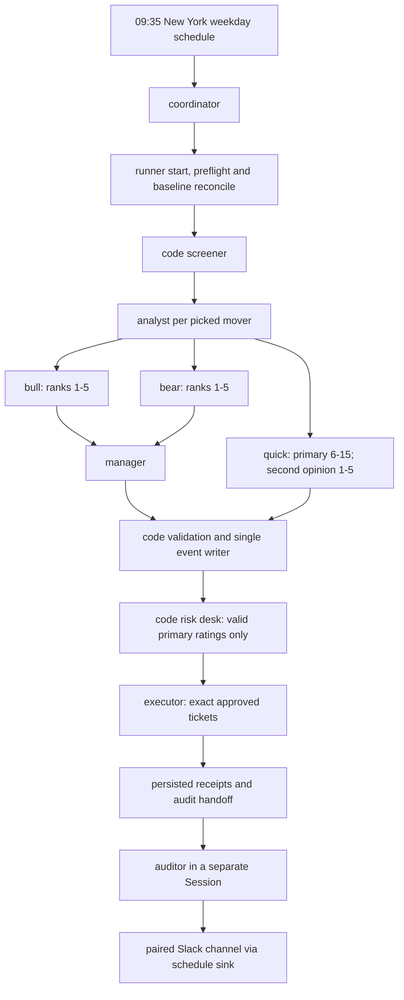

# Agent layer

This is a dry-run deployment package for MooWoo Desk's 17-27 November 2026
paper-trading experiment. It does not prove live Qoder execution, broker safety,
model quality or Slack delivery. PREREGISTRATION.md remains binding and unchanged.
The task enumerates eight roles, including separate bull and bear agents, so this
package contains eight agents despite the deployment brief saying seven.

## Agent graph and ownership



| Agent | Job | Limit |
| --- | --- | --- |
| coordinator | Run screen, delegate research, ingest validated calls, invoke code risk desk, dispatch tickets, persist audit handoff | No broker orders, ratings, sizing or discretionary risk decisions |
| analyst | Point-in-time factual brief with item IDs, publication times and sources | Only the five specified Moomoo news/quote reads; no advice |
| bull | News justifies the move's magnitude | At most 150 words, brief citations only |
| bear | News does not justify the move's magnitude | At most 150 words, brief citations only |
| manager | Independent debate classification | Four classes and strict JSON; no quick opinion before its call |
| quick | One-pass primary calls for 6-15, independent second opinions for 1-5 | Cheaper model, same schema; second opinions cannot drive sizing |
| executor | Verify simulation account, send exact code-approved tool/args | Only simulated order tools; mismatches halt, ambiguous submissions are reconciled rather than retried |
| auditor | Independently reconcile tickets/fills, drawdown, decisions and reflections | New Session, no order tools, no executor delegation, no invented metrics |

The coordinator roster contains six children: analyst, bull, bear, manager, quick,
executor. Auditor is deliberately excluded because a Qoder child is a separate
Thread in the same Session, not a separate Session. Each worker returns results;
only the coordinator writes its trading-session event log. The auditor may append
only after ownership transfers under a durable lock. Keep raw transcripts in
separate per-decision/per-role files. Actual credit costs and code-computed setup
scores are runtime inputs, not model estimates.

## Rating boundary

`schemas/rating.schema.json` is JSON Schema 2020-12. `validate_rating(obj, cutoff)`
adds semantic checks that JSON Schema cannot express across external inputs. It
returns a detached validated dictionary or raises `moowoo.events.ValidationError`.

| Field | Meaning |
| --- | --- |
| decisionId | Trusted trading-run identity, `runId:TICKER` |
| ticker | Screened symbol |
| class | explained_up, explained_down, unexplained_up, unexplained_down; suffix is the observed move |
| confidence | Finite number 0..1, confidence in the preregistered H1 forecast; booleans rejected |
| tier | debate or quick |
| reason | Nonempty explanation, at most 600 characters |
| evidence | List of exact `{id, headline, source, publishedAt}` items; unique IDs |
| newsCutoff | UTC timestamp equal to the caller's trusted cutoff |
| expectedMove | `{direction: "up" or "down", horizon: integer}`; horizon is sessions |
| wrongIf | Observable falsification condition |
| model | Actual model identifier |
| promptVersion | Runtime hash from `scripts/hash_prompts.py` |

Explained calls forecast continuation over five sessions; unexplained calls
forecast reversal over three. An explained_down call is a down forecast, not a
short order. An unexplained_up call is also a down forecast. Code decides which
calls can map to long-only trades. Empty evidence is permitted. Market-wide
selling alone is insufficient to explain a stock-specific abnormal residual move;
the fixed market-selloff evaluation expects unexplained_down.

Missing or unknown fields, wrong types, nonfinite/out-of-range confidence, invalid
classes, duplicate evidence IDs, inconsistent forecast direction/horizon, invalid
timestamps and lookahead evidence are rejected. Timestamps must use UTC `Z`.
The JSON schema checks structure, enums, dates and forecast mapping; Python also
checks trusted identity/cutoff, unique IDs and evidence chronology. Callers must
retain original transcripts to check factual support; a valid shape is not truth.

`rating_to_event` returns the existing rating payload, retaining evidence,
expectedMove, wrongIf, model, promptVersion and secondOpinion as extra fields.
It requires explicit transcriptRef, credits and setupScore. `decisionId` is passed
separately to `EventLog.append`, which creates the common envelope and hash chain.
No change to events.py or ledger.py is needed. `log_rating` checks the screened
identity and logs a rejected call as `halt`, `scope=ticker`, `disposition=skip`,
`stage=rating_validation`, then returns None. There is no `skip` event type in v0.
It never emits an order. A rejected second opinion remains marked as such and
must not veto or replace the primary by accident.

Real ingestion entry point (single writer only):

```powershell
.venv/Scripts/python scripts/ingest_rating.py --input .cache/rating.json --log .cache/2026-11-17-us.jsonl --run-id 2026-11-17-us --ticker BEAT --cutoff 2026-11-16T21:00:00Z --transcript-ref transcripts/BEAT.json --credits 1.5 --setup-score 3
```

Use actual runtime values rather than the example. Add `--second-opinion` for the
top-five quick outputs. The risk-desk consumer must filter `secondOpinion=true`
and use only accepted primary ratings; event storage alone does not enforce that.

## News cutoff and session dates

For a close move, cutoff is that move session's actual regular close. For a gap,
it is that session's actual regular open. Use the exchange calendar, including
early closes, and convert to UTC; do not use retrieval time or the morning run's
clock. Exactly-at-cutoff evidence is allowed; even one microsecond later is not.
Undated, ambiguously timed or later-revised news is excluded and disclosed.
Later quotes and financial snapshots cannot silently become historical evidence.

The morning run starts at 09:35 New York (22:35 SGT), after the open and the first-five-minutes rule.
The existing screener is a completed-daily-bar screener, not a premarket gap feed.
The runtime start gate skips that premarket schedule; do not screen or wait
under its lease. For an eligible morning run, screening uses the last completed US session. `screen.py`
uses its `--asof` date for its log runId. Preserve that separate source log and
map each rating to the upcoming trade session's runId. A gap chosen from a daily
bar uses that day's open as the news cutoff even though full-day volume was used
for screening. This is disclosed rather than pretending to detect a live gap.
A future intraday adapter is outside this change.

## Permissions and account boundary

`agents/permissions.json` is the canonical named Moomoo tool policy. Every
`agent.json` embeds those same configs under `tools[type=mcp_toolset].configs`.
Qoder uses `mcp_server_name`, raw tool `name`, `enabled`, and
`permission_policy: {type: "always_ask"|"always_allow"|"always_deny"}`. All seven named
real-money/crypto order tools are disabled and always denied everywhere. The
three simulated order tools default to `always_ask`, only for executor.
`qca_deploy.py --executor-approval allow` selects `always_allow`; applying that
override requires a logged decision through `--approval-log`. See
[execution](execution.md) for approval expiry and receipt handling. Bull, bear, manager,
quick and coordinator have no Moomoo reads enabled. Analyst has the five specified
reads. Executor has the five specified account/order reads; auditor has account,
cash, positions and order history reads.

No empty built-in allowlist is used: Qoder interprets an empty `enabled_tools`
as ALL built-ins. Coordinator and auditor get Bash/Read/Write; executor gets
Read; analyst and classifiers have no built-in toolset. All MCP connections use
name `moomoo`, type `url`, and a configured official Streamable HTTP endpoint.
Credentials attach through the vault named `moomoo-mcp`, never inline headers.

The docs do not establish a wildcard/default-deny MCP policy. Before apply,
provide a verified complete `moomoo_tool_names` inventory. The deployment builder
disables every additional discovered tool not explicitly permitted. Recheck this
inventory whenever the MCP changes. Unknown future tools are not guaranteed denied
by the static named policy. Verify effective permissions in a sandbox before use.
Built-in shell access and prompts are not a tamper-proof broker safety boundary.
Code ticket checking, account checking and exclusive submission must also be
verified at the execution integration; this package does not claim those live tests.

Executor reads account-context.json generated from session environment variables
MOOMOO_ACCOUNT_ID, MOOMOO_MARKET and MOOMOO_CHALLENGE_TITLE. It confirms the exact account
via sim_trade_account_list, integer account_type=2, title and US market before any
batch. Missing or mismatched fields halt without an order. We have not fetched the
remaining Moomoo response schemas. Confirmed account fields are `account_id`,
`account_type`, `market_id`, and `account_title`; US market is integer `100`.
Cash, empty-position envelopes, placement/cancellation and history fields are
confirmed by scrubbed ordinary-paper captures in `fixtures/broker/`; see
`docs/execution.md` for the remaining provisional row fields. The prompt fails closed on
unknown shape. Account values and exact ticket args are never edited by the model.
All cancels/modifications need their own code-approved tickets. No blind retries.

## Evaluation and prompt freeze

Four fixed cases live under `evals/`: earnings beat/raised guidance, news-free
drop, market-only selloff and a post-cutoff headline. Each case declares two chains:
analyst brief -> bull and bear independently -> manager, and brief -> quick.
The supplied analyst brief is the fixed input, not another model call. Neither
helper calls Qoder or any model. Stub tests prove wiring, not model quality.

`scripts/qca_evals.py prepare --out .cache/eval-requests` writes system/user
messages for bull, bear and quick with runtime model and promptVersion. Store
unaltered responses in `<raw>/<case-id>/bull.txt`, `bear.txt`, `quick.txt`.
Run prepare again with `--outputs <raw>` to include manager's request containing
both validated arguments and the same brief. Quick output never enters manager's
request. Save manager's raw response as `manager.txt` beside the others.
All commands use `.venv/Scripts/python` locally and `python3` in Linux cloud.

`scripts/qca_evals.py collect --outputs <raw> --out .cache/qoder-evals` collects
all four transcripts and their exact requests. Run
`scripts/run_evals.py --outputs .cache/qoder-evals --report .cache/evals/latest.json`.
The default chain mode checks messages, argument identity/citations, model/hash,
tier, classification, evidence membership and cutoff for both manager and quick.
All four cases must pass both paths for exit status 0. Missing/malformed output
fails rather than disappearing. Only the late-news case accepts a specific
lookahead rejection; arbitrary validation failures never count as passes.
`--mode single` retains historical single-output smoke-result inspection.
`--previous` selects a comparison report; otherwise the old report is read before
replacement and full output differences are retained.

Manager and quick must return raw JSON with no Markdown fences. Manager reason
is at most 600 characters; quick reason is at most 3 sentences and at most 400
characters. The shared schema/ingestion limit stays at 600 characters. Ingestion tolerates exactly one complete JSON fence and
logs a warning when stripping it; prose, multiple blocks and malformed JSON fail.
After manager has decided, ingestion accepts `--bull-output` / `--bear-output`
JSON files and records their argument text, truncated to 600 characters each.
`--quick-output` adds only its class/confidence as `quickSecondOpinion`, without
changing manager's decision. Log the quick rating separately with
`--second-opinion` for provenance and keep it out of risk and H1-H3 denominators.

```powershell
.venv/Scripts/python scripts/hash_prompts.py
```

Hash format v1: lexicographically sorted relative paths for every
`agents/*/system.md`, `schemas/rating.schema.json` and `agents/permissions.json`.
Normalize prompt newlines to LF; JSON content is UTF-8 canonical JSON with sorted
keys, compact separators and no nonfinite numbers. Canonical-concatenate as a JSON
array of `{path, content}` records using the same encoding, then SHA-256. Paths
and JSON framing prevent ambiguous file-boundary concatenations. Agent models and
cloud IDs are recorded separately in the deployment snapshot and AGENTS.md;
this requested prompt hash does not cover all agent.json fields.

On every redeploy, bump `REPO_REVISION` to the reviewed, merged main commit SHA.
It must remain an exact 40-character SHA, never a floating branch. Regenerate
payloads from that same revision so the setup prompt-hash check agrees. No cloud
setup, API call or redeployment is implied by offline payload tests.

The preregistration addendum is deliberately NOT appended here. The owner must
commit the exact computed hash as a dated addendum before the first live paper
order. Pending prompt registration cannot authorize a trade. Local revision
`agents-v1` identifies this artifact set; cloud Agent IDs and versions are pending.
No Qoder skills are bound (`skills: []`), so there are no fabricated skill IDs or
versions. Future skill bindings must pin an actual immutable epoch-microsecond
version using `{type, skill_id, version}` and record it in AGENTS.md.

## Deployment payloads and field decisions

Docs were retrieved on 17 Nov 2026 (UTC). Sources:

- [Defining an agent](https://docs.qoder.com/cloud-agents/define-agent.md)
- [Tools](https://docs.qoder.com/cloud-agents/tools.md)
- [Permission policies](https://docs.qoder.com/cloud-agents/permission-policies.md)
- [Multiagent](https://docs.qoder.com/cloud-agents/multi-agents.md)
- [Environments](https://docs.qoder.com/cloud-agents/environments.md)
- [Vaults](https://docs.qoder.com/cloud-agents/vaults.md)
- [Schedules](https://docs.qoder.com/cloud-agents/api/forward/schedules/create.md)
- [Skill schemas](https://docs.qoder.com/cloud-agents/api/skills/schemas.md)
- [Agent schemas](https://docs.qoder.com/cloud-agents/api/agents/schemas.md)
- [Forward templates](https://docs.qoder.com/cloud-agents/api/forward/templates/create.md)
- [Session creation](https://docs.qoder.com/cloud-agents/api/sessions/create.md)
- [Vault listing](https://docs.qoder.com/cloud-agents/api/vaults/list.md)
- [Model list](https://docs.qoder.com/cloud-agents/api/models/list.md), found through [llms.txt](https://docs.qoder.com/llms.txt)
- [Model selector](https://docs.qoder.com/qoder/model-selector.md) and [CLI model IDs](https://docs.qoder.com/cli/model.md)

| Decision | Evidence or explicit assumption |
| --- | --- |
| ultimate for all except quick; efficient for quick | Cloud model-list example names ultimate; CLI docs name efficient, selector describes its lower cost. Account availability and exact Cloud efficient ID remain unverified. Apply checks both IDs and requires efficient price_factor below ultimate; it never substitutes models. |
| Agent system field | API `system` contains prompt text. Local `metadata.system_prompt_path` is our provenance field, not an API path loader. Builder reads system.md into system. |
| Child roster | `multiagent: {type: coordinator, agents: [{type: agent, id, version: 1}]}`. Newly created child versions are pinned at 1; no latest aliases. Auditor is separate. |
| MCP | `mcp_servers: [{name, type: url, url}]`, `mcp_toolset.mcp_server_name`, `configs[].permission_policy.type`. Official URL is an operator binding. |
| Environment | `config.type=cloud`, `packages`, `setup_script`, `startup_script`. Setup clones the repository, checks out pinned `REPO_REVISION`, installs `python3 -m pip install -e '.[dev]'`, runs `python3 -m pytest -q` once with a loud failure/exit, then verifies risk-script presence and prompt hash. Dependencies install on Linux only; no local NumPy/pandas changes. |
| Environment variables | Session/Template `environment_variables`, not an invented environment config field. Startup writes account-context.json; executor fails closed if it is absent. Qoder startup failures do not themselves abort a Session. |
| Vault by name | Resolve exactly one active vault whose display_name is moomoo-mcp. Cloud Sessions use `vault_ids`; Forward Templates use `vaults: {vault_id: {enabled: true}}`. There is no invented vault_name request field. |
| Schedules | Forward schedules require identity_id, template_id and environment_id. Builder therefore creates coordinator and auditor Templates with the Agent configuration copied into them; a Template does not accept a Cloud Agent ID as its execution definition. |
| Morning | `trigger_policy={type: cron, expression: "35 9 * * 1-5", timezone: America/New_York}`. |
| Watcher | Three cron schedules in America/New_York: `0,30 10-15 * * 1-5`, `55 15 * * 1-5`, and `55 12 27 11 *`; every half hour through 15:30 plus 15:55, with a 12:55 tick on the early close. The 09:35 morning run covers the open. |
| Audit delivery | New auditor Session daily at 16:10 New York, `sinks: [{type: im_channel, channel_pairing_id}]`. Pairing must belong to the auditor Template/Identity and point to Slack. Channel ID/credentials are not invented. The supplied runtime adds 13:10 New York on 27 November; its close +10 to +45 minute audit gate rejects the late 16:10 duplicate. |
| Trading window | Schedule API documents no creation-time start/end bound. Metadata window dates are labels, NOT enforcement. Runtime calendar guards reject holidays and out-of-window order work, while allowing final receipt reconciliation and saving after close. The supplied runtime proposes stop_at=2026-11-28T06:00:00+08:00; API acceptance remains unverified. Archive schedules after the challenge. |
| API references | `${...}` strings are local dry-run manifest placeholders, NOT Qoder API syntax. Apply resolves them before POST and fails on unresolved references. |

Dry run, no credentials or network:

```powershell
.venv/Scripts/python scripts/qca_deploy.py
```

The base deployment builder prints the environment, eight Agents, two Templates, five schedules, vault
lookup and an example separate auditor Cloud Session payload. It does not submit
the example Session. Audit handoff is a persisted manifest consumed by the separate
audit schedule, not an automatic child-thread launch. An immediate independent
audit requires an external runner or an operator to start that auditor Session.

For future authorized deployment, create a nonsecret JSON settings file containing
MOOMOO_MCP_URL, MOOMOO_ACCOUNT_ID, MOOMOO_MARKET (`100`), MOOMOO_CHALLENGE_TITLE,
REPO_REVISION (published 40-character SHA), IDENTITY_ID,
SLACK_CHANNEL_PAIRING_ID and the full moomoo_tool_names list. These are local
binding names, not raw Qoder API field names. Store only QODER_PAT in ignored .env.
`--settings <file> --apply --stage resources` reads that PAT, verifies model
cost/availability and vault lookup, then creates the environment, Agents and
Templates in dependency order. It does not create schedules. Every successful
creation writes a nonsecret receipt to `.cache/qca-deployment.jsonl` (override
with `--receipts`). It was NOT run. Receipts include IDs, never tokens. Cloud
creation is not transactional; after failure inspect receipts/remote state before
retrying. Recorded resources are not silently recreated or updated. For an
authorized in-place redeployment, add `--update --apply --stage resources` with
the existing `--receipts` file. The deployer requires all eleven resources, reads
current Agent versions for optimistic concurrency, and updates in dependency
order. Coordinator child references pin newly returned versions. Environments
and Forward Templates have no version/OCC field in their update API. Receipts
retain the existing IDs and are atomically replaced after each update; stdout
masks IDs. This mode never creates resources or touches schedules. Verify remote
state by GET after completion and after any failure before retrying.

Next pair the newly created auditor Template and Identity to the intended Slack
channel. Put the resulting SLACK_CHANNEL_PAIRING_ID in the settings file; it is
not required for the resources stage. Verify effective Identity Config has no
permission/model overrides. Once all runtime gates below are satisfied, a future
explicitly authorized `--apply --stage schedules` reads the same receipts and
creates schedules referencing those resources. The supplied runtime adds the
early-close audit schedule; inspect the integrated dry-run payload before apply. Only Forward POSTs use
the documented Idempotency-Key. Schedule creation can start future runs. A pairing
from another Template is invalid. Neither stage has been run in this task.

## Integration gates and persistence

Cloud containers are recreated and wiped; local JSONL is not durable by itself.
Every run must restore verified prior state, retain immutable transcripts and
persist the log plus trusted terminal hash/count and ticket receipts before
releasing ownership. An order with uncertain persistence is a halt, not a retry.

The session procedures in coordinator/system.md and auditor/system.md target
`scripts/run_session.py` from the separately supplied runtime implementation.
The runner is present in this checkout. Integrate the companion ingestion,
dispatch-check and renewal commands before deployment. If any command is absent
or incompatible, halt rather than invoke direct
planning/execution CLIs. No watcher agent exists: coordinator runs `--kind watch`.
There is no `agents/AGENTS.md`; the repository-root AGENTS.md is the handbook.

Each fresh Session runs `start` to restore the dedicated runtime ledger and
acquire the global 45-minute lease. Morning and watch then run `preflight`,
`reconcile` (baseline), `plan`, `prepare`, `record`, `reconcile`, `finish`.
Morning screening and rating ingestion occur only after baseline reconciliation;
watch does no classification. Auditor runs `start`, `reconcile`, `grade_calls`,
`score_hypotheses`, `finish` in its independent Session, without order authority.
Use the returned input directory for exact account/snapshot/market/receipt files;
the prompts enumerate each required file and handoff. Never invent missing data.

`finish` is the final save phase; the parser has no phase named `save`.
`abort` is the failure-save path when ownership permits. Stop at every phase on
`skipped=true`, nonzero exit or lease expiry. Skipped phases already save/unlock;
CLI data errors may report successful automatic abort. Do not repeat cleanup in
those cases. Preserve local evidence and report a failed save; never resume
trading after persistence failure or dispatch after an unsuccessful prepare.
Successful prepare checkpoints the exact attempts. Before EACH handoff, require
`python3 scripts/dispatch_check.py --kind K --decision-id <id>` to return ok:true;
executor receives its exact args for one order. AUTONOMY-01 plus deployed
always_allow authorizes paper execution without a further approval request.
Coordinator alone writes files, runs commands and checks date -u. Children never
write files or verify time. After baseline reconciliation, use session_info and
gather_inputs for both kinds; morning routes candidates to children and saves
verbatim replies under `<inputs>/replies/<decisionId>.<role>.json`, then runs
ingest_ratings. Fetch quotes LAST via analyst and convert_quotes before plan.
Use the exact commands and receipt contracts in [runtime.md](runtime.md).
Optional gaps are logged; missing cost telemetry is unavailable (credits null).
Renew below 10 minutes remaining when work remains, up to 120 minutes total;
never continue after expiry.
The 30-minute watch schedule does not guarantee continuous stop monitoring.

The runtime uses a separate Git ledger branch with checked chains, handoffs,
exclusive ownership and conflict detection; source and runtime are separate
repositories. Secret delivery, durable cloud restore/save, effective schedules,
Moomoo behavior and Slack delivery still require live verification. This branch
changes no runtime Python, schedules, permissions, frozen values or registration.
Dated promptVersion addenda and AUTONOMY-01 already exist. This prompt revision
still requires a committed matching hash addendum before execution. Offline
prompt tests do not establish a model evaluation pass or live integration success.


## Debate output contract (build/13b-debate-format)

Bull and bear return raw JSON only, without Markdown fences, with exactly
`decisionId`, `stance`, `argument`, and `itemIds`. No extra provenance fields:
`ticker`, `newsCutoff`, `model`, and `promptVersion` remain input context.
`argument` is at most 150 words. Citations must identify supplied brief items
published at or before the trusted cutoff; exactly-at-cutoff items are eligible.
Neither arguments nor manager reasoning may rely on later items, including later
items present in the brief or another agent's output. Use empty citations when
nothing qualifies. The strict collector is unchanged; regression tests cover
both roles, extra keys, later citations, and valid boundary/empty citations.
Embedded agent JSON prompts mirror the authoritative system.md files.

Recompute `scripts/hash_prompts.py` after prompt changes. Redeploy only the
pushed main SHA and verify existing resources by GET before read-only evals.
Cloud results for this revision are recorded separately after actual execution;
this contract change alone does not establish an eval pass or authorize orders.
