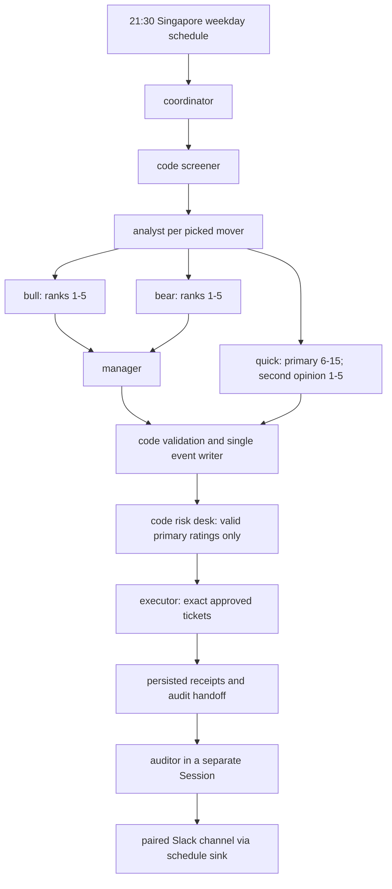

# Agent layer

This is a dry-run deployment package for MooWoo Desk's 17-27 November 2026
paper-trading experiment. It does not prove live Qoder execution, broker safety,
model quality or Slack delivery. PREREGISTRATION.md remains binding and unchanged.
The task enumerates eight roles, including separate bull and bear agents, so this
package contains eight agents despite the deployment brief saying seven.

## Agent graph and ownership



| Agent | Job | Limit |
| --- | --- | --- |
| coordinator | Run screen, delegate research, ingest validated calls, invoke code risk desk, dispatch tickets, persist audit handoff | No broker orders, ratings, sizing or discretionary risk decisions |
| analyst | Point-in-time factual brief with item IDs, publication times and sources | Only the five specified Moomoo news/quote reads; no advice |
| bull | News justifies the move's magnitude | At most 150 words, brief citations only |
| bear | News does not justify the move's magnitude | At most 150 words, brief citations only |
| manager | Independent debate classification | Four classes and strict JSON; no quick opinion before its call |
| quick | One-pass primary calls for 6-15, independent second opinions for 1-5 | Cheaper model, same schema; second opinions cannot drive sizing |
| executor | Verify simulation account, send exact code-approved tool/args | Only simulated order tools; mismatches halt, ambiguous submissions are reconciled rather than retried |
| auditor | Independently reconcile tickets/fills, drawdown, decisions and reflections | New Session, no order tools, no executor delegation, no invented metrics |

The coordinator roster contains six children: analyst, bull, bear, manager, quick,
executor. Auditor is deliberately excluded because a Qoder child is a separate
Thread in the same Session, not a separate Session. Each worker returns results;
only the coordinator writes its trading-session event log. The auditor may append
only after ownership transfers under a durable lock. Keep raw transcripts in
separate per-decision/per-role files. Actual credit costs and code-computed setup
scores are runtime inputs, not model estimates.

## Rating boundary

`schemas/rating.schema.json` is JSON Schema 2020-12. `validate_rating(obj, cutoff)`
adds semantic checks that JSON Schema cannot express across external inputs. It
returns a detached validated dictionary or raises `moowoo.events.ValidationError`.

| Field | Meaning |
| --- | --- |
| decisionId | Trusted trading-run identity, `runId:TICKER` |
| ticker | Screened symbol |
| class | explained_up, explained_down, unexplained_up, unexplained_down; suffix is the observed move |
| confidence | Finite number 0..1, confidence in the preregistered H1 forecast; booleans rejected |
| tier | debate or quick |
| reason | Nonempty explanation, at most 600 characters |
| evidence | List of exact `{id, headline, source, publishedAt}` items; unique IDs |
| newsCutoff | UTC timestamp equal to the caller's trusted cutoff |
| expectedMove | `{direction: "up" or "down", horizon: integer}`; horizon is sessions |
| wrongIf | Observable falsification condition |
| model | Actual model identifier |
| promptVersion | Runtime hash from `scripts/hash_prompts.py` |

Explained calls forecast continuation over five sessions; unexplained calls
forecast reversal over three. An explained_down call is a down forecast, not a
short order. An unexplained_up call is also a down forecast. Code decides which
calls can map to long-only trades. Empty evidence is permitted. Market-wide
selling alone is insufficient to explain a stock-specific abnormal residual move;
the fixed market-selloff evaluation expects unexplained_down.

Missing or unknown fields, wrong types, nonfinite/out-of-range confidence, invalid
classes, duplicate evidence IDs, inconsistent forecast direction/horizon, invalid
timestamps and lookahead evidence are rejected. Timestamps must use UTC `Z`.
The JSON schema checks structure, enums, dates and forecast mapping; Python also
checks trusted identity/cutoff, unique IDs and evidence chronology. Callers must
retain original transcripts to check factual support; a valid shape is not truth.

`rating_to_event` returns the existing rating payload, retaining evidence,
expectedMove, wrongIf, model, promptVersion and secondOpinion as extra fields.
It requires explicit transcriptRef, credits and setupScore. `decisionId` is passed
separately to `EventLog.append`, which creates the common envelope and hash chain.
No change to events.py or ledger.py is needed. `log_rating` checks the screened
identity and logs a rejected call as `halt`, `scope=ticker`, `disposition=skip`,
`stage=rating_validation`, then returns None. There is no `skip` event type in v0.
It never emits an order. A rejected second opinion remains marked as such and
must not veto or replace the primary by accident.

Real ingestion entry point (single writer only):

```powershell
.venv/Scripts/python scripts/ingest_rating.py --input .cache/rating.json --log .cache/2026-11-17-us.jsonl --run-id 2026-11-17-us --ticker BEAT --cutoff 2026-11-16T21:00:00Z --transcript-ref transcripts/BEAT.json --credits 1.5 --setup-score 3
```

Use actual runtime values rather than the example. Add `--second-opinion` for the
top-five quick outputs. The risk-desk consumer must filter `secondOpinion=true`
and use only accepted primary ratings; event storage alone does not enforce that.

## News cutoff and session dates

For a close move, cutoff is that move session's actual regular close. For a gap,
it is that session's actual regular open. Use the exchange calendar, including
early closes, and convert to UTC; do not use retrieval time or the morning run's
clock. Exactly-at-cutoff evidence is allowed; even one microsecond later is not.
Undated, ambiguously timed or later-revised news is excluded and disclosed.
Later quotes and financial snapshots cannot silently become historical evidence.

21:30 SGT is 08:30 New York during this November window, before the 22:30 SGT open.
The existing screener is a completed-daily-bar screener, not a premarket gap feed.
Morning screening therefore uses the last completed US session. `screen.py`
uses its `--asof` date for its log runId. Preserve that separate source log and
map each rating to the upcoming trade session's runId. A gap chosen from a daily
bar uses that day's open as the news cutoff even though full-day volume was used
for screening. This is disclosed rather than pretending to detect a live gap.
A future intraday adapter is outside this change.

## Permissions and account boundary

`agents/permissions.json` is the canonical named Moomoo tool policy. Every
`agent.json` embeds those same configs under `tools[type=mcp_toolset].configs`.
Qoder uses `mcp_server_name`, raw tool `name`, `enabled`, and
`permission_policy: {type: "always_ask"|"always_allow"|"always_deny"}`. All seven named
real-money/crypto order tools are disabled and always denied everywhere. The
three simulated order tools default to `always_ask`, only for executor.
`qca_deploy.py --executor-approval allow` selects `always_allow`; applying that
override requires a logged decision through `--approval-log`. See
[execution](execution.md) for approval expiry and receipt handling. Bull, bear, manager,
quick and coordinator have no Moomoo reads enabled. Analyst has the five specified
reads. Executor has the five specified account/order reads; auditor has account,
cash, positions and order history reads.

No empty built-in allowlist is used: Qoder interprets an empty `enabled_tools`
as ALL built-ins. Coordinator and auditor get Bash/Read/Write; executor gets
Read; analyst and classifiers have no built-in toolset. All MCP connections use
name `moomoo`, type `url`, and a configured official Streamable HTTP endpoint.
Credentials attach through the vault named `moomoo-mcp`, never inline headers.

The docs do not establish a wildcard/default-deny MCP policy. Before apply,
provide a verified complete `moomoo_tool_names` inventory. The deployment builder
disables every additional discovered tool not explicitly permitted. Recheck this
inventory whenever the MCP changes. Unknown future tools are not guaranteed denied
by the static named policy. Verify effective permissions in a sandbox before use.
Built-in shell access and prompts are not a tamper-proof broker safety boundary.
Code ticket checking, account checking and exclusive submission must also be
verified at the execution integration; this package does not claim those live tests.

Executor reads account-context.json generated from session environment variables
MOOMOO_ACCOUNT_ID, MOOMOO_MARKET and MOOMOO_CHALLENGE_TITLE. It confirms the exact account
via sim_trade_account_list, integer account_type=2, title and US market before any
batch. Missing or mismatched fields halt without an order. We have not fetched the
remaining Moomoo response schemas. Confirmed account fields are `account_id`,
`account_type`, `market_id`, and `account_title`; US market is integer `100`.
Other response fields remain provisional in `moowoo/broker_fields.py` and must
be checked against real responses. The prompt fails closed on
unknown shape. Account values and exact ticket args are never edited by the model.
All cancels/modifications need their own code-approved tickets. No blind retries.

## Evaluation and prompt freeze

Four synthetic, fixed cases live under `evals/`: earnings beat/raised guidance,
news-free drop, market-only selloff and a post-cutoff headline. Collect actual
Qoder manager/quick outputs as `<case-id>.json` in a separate directory. Pass the
brief with the actual model name, tier and computed promptVersion. Do not fabricate
model output or treat generated test fixtures as measured model quality.

```powershell
.venv/Scripts/python scripts/run_evals.py --outputs .cache/qoder-evals --report .cache/evals/latest.json
```

The runner calls no model. It checks every output, expected class, identity and
evidence membership, and diffs full outputs against the previous report. By
default it reads the old `--report` before replacing it; `--previous` selects
another baseline. Missing/malformed output fails, not skips. For the late-news
case only a lookahead-specific rejection or unexplained_up with eligible evidence
passes. A random validation error does not pass that case. All four must pass for
exit status 0. Run separately for manager and quick directories to compare tiers.

```powershell
.venv/Scripts/python scripts/hash_prompts.py
```

Hash format v1: lexicographically sorted relative paths for every
`agents/*/system.md`, `schemas/rating.schema.json` and `agents/permissions.json`.
Normalize prompt newlines to LF; JSON content is UTF-8 canonical JSON with sorted
keys, compact separators and no nonfinite numbers. Canonical-concatenate as a JSON
array of `{path, content}` records using the same encoding, then SHA-256. Paths
and JSON framing prevent ambiguous file-boundary concatenations. Agent models and
cloud IDs are recorded separately in the deployment snapshot and AGENTS.md;
this requested prompt hash does not cover all agent.json fields.

The preregistration addendum is deliberately NOT appended here. The owner must
commit the exact computed hash as a dated addendum before the first live paper
order. Pending prompt registration cannot authorize a trade. Local revision
`agents-v1` identifies this artifact set; cloud Agent IDs and versions are pending.
No Qoder skills are bound (`skills: []`), so there are no fabricated skill IDs or
versions. Future skill bindings must pin an actual immutable epoch-microsecond
version using `{type, skill_id, version}` and record it in AGENTS.md.

## Deployment payloads and field decisions

Docs were retrieved on 17 Nov 2026 (UTC). Sources:

- [Defining an agent](https://docs.qoder.com/cloud-agents/define-agent.md)
- [Tools](https://docs.qoder.com/cloud-agents/tools.md)
- [Permission policies](https://docs.qoder.com/cloud-agents/permission-policies.md)
- [Multiagent](https://docs.qoder.com/cloud-agents/multi-agents.md)
- [Environments](https://docs.qoder.com/cloud-agents/environments.md)
- [Vaults](https://docs.qoder.com/cloud-agents/vaults.md)
- [Schedules](https://docs.qoder.com/cloud-agents/api/forward/schedules/create.md)
- [Skill schemas](https://docs.qoder.com/cloud-agents/api/skills/schemas.md)
- [Agent schemas](https://docs.qoder.com/cloud-agents/api/agents/schemas.md)
- [Forward templates](https://docs.qoder.com/cloud-agents/api/forward/templates/create.md)
- [Session creation](https://docs.qoder.com/cloud-agents/api/sessions/create.md)
- [Vault listing](https://docs.qoder.com/cloud-agents/api/vaults/list.md)
- [Model list](https://docs.qoder.com/cloud-agents/api/models/list.md), found through [llms.txt](https://docs.qoder.com/llms.txt)
- [Model selector](https://docs.qoder.com/qoder/model-selector.md) and [CLI model IDs](https://docs.qoder.com/cli/model.md)

| Decision | Evidence or explicit assumption |
| --- | --- |
| ultimate for all except quick; efficient for quick | Cloud model-list example names ultimate; CLI docs name efficient, selector describes its lower cost. Account availability and exact Cloud efficient ID remain unverified. Apply checks both IDs and requires efficient price_factor below ultimate; it never substitutes models. |
| Agent system field | API `system` contains prompt text. Local `metadata.system_prompt_path` is our provenance field, not an API path loader. Builder reads system.md into system. |
| Child roster | `multiagent: {type: coordinator, agents: [{type: agent, id, version: 1}]}`. Newly created child versions are pinned at 1; no latest aliases. Auditor is separate. |
| MCP | `mcp_servers: [{name, type: url, url}]`, `mcp_toolset.mcp_server_name`, `configs[].permission_policy.type`. Official URL is an operator binding. |
| Environment | `config.type=cloud`, `packages`, `setup_script`, `startup_script`. Setup clones public repo, checks out a supplied commit SHA, installs editable package with --no-deps and verifies risk-script presence and prompt hash. Linux cloud packages provide dependencies; local Windows NumPy/pandas were never installed/upgraded. |
| Environment variables | Session/Template `environment_variables`, not an invented environment config field. Startup writes account-context.json; executor fails closed if it is absent. Qoder startup failures do not themselves abort a Session. |
| Vault by name | Resolve exactly one active vault whose display_name is moomoo-mcp. Cloud Sessions use `vault_ids`; Forward Templates use `vaults: {vault_id: {enabled: true}}`. There is no invented vault_name request field. |
| Schedules | Forward schedules require identity_id, template_id and environment_id. Builder therefore creates coordinator and auditor Templates with the Agent configuration copied into them; a Template does not accept a Cloud Agent ID as its execution definition. |
| Morning | `trigger_policy={type: cron, expression: "30 21 * * 1-5", timezone: Asia/Singapore}`. |
| Watcher | Three cron schedules in America/New_York: `30 9 * * 1-5`, `0,30 10-15 * * 1-5`, `0 16 * * 1-5`; together every 30 minutes 09:30-16:00. First trigger only checks/queues; no first-five-minute orders. |
| Audit delivery | New auditor Session daily at 16:10 New York, `sinks: [{type: im_channel, channel_pairing_id}]`. Pairing must belong to the auditor Template/Identity and point to Slack. Channel ID/credentials are not invented. Early-close days receive their daily report later at this fixed time. |
| Trading window | Schedule API documents no creation-time start/end bound. Metadata window dates are labels, NOT enforcement. Code/calendar guards and prompt instructions must reject holidays, out-of-window sessions and post-early-close work. Archive schedules after the challenge. |
| API references | `${...}` strings are local dry-run manifest placeholders, NOT Qoder API syntax. Apply resolves them before POST and fails on unresolved references. |

Dry run, no credentials or network:

```powershell
.venv/Scripts/python scripts/qca_deploy.py
```

This prints the environment, eight Agents, two Templates, five schedules, vault
lookup and an example separate auditor Cloud Session payload. It does not submit
the example Session. Audit handoff is a persisted manifest consumed by the separate
audit schedule, not an automatic child-thread launch. An immediate independent
audit requires an external runner or an operator to start that auditor Session.

For future authorized deployment, create a nonsecret JSON settings file containing
MOOMOO_MCP_URL, MOOMOO_ACCOUNT_ID, MOOMOO_MARKET (`100`), MOOMOO_CHALLENGE_TITLE,
REPO_REVISION (published 40-character SHA), IDENTITY_ID,
SLACK_CHANNEL_PAIRING_ID and the full moomoo_tool_names list. These are local
binding names, not raw Qoder API field names. Store only QODER_PAT in ignored .env.
`--settings <file> --apply --stage resources` reads that PAT, verifies model
cost/availability and vault lookup, then creates the environment, Agents and
Templates in dependency order. It does not create schedules. Every successful
creation writes a nonsecret receipt to `.cache/qca-deployment.jsonl` (override
with `--receipts`). It was NOT run. Receipts include IDs, never tokens. Cloud
creation is not transactional; after failure inspect receipts/remote state before
retrying. Recorded resources are not silently recreated or updated.

Next pair the newly created auditor Template and Identity to the intended Slack
channel. Put the resulting SLACK_CHANNEL_PAIRING_ID in the settings file; it is
not required for the resources stage. Verify effective Identity Config has no
permission/model overrides. Once all runtime gates below are satisfied, a future
explicitly authorized `--apply --stage schedules` reads the same receipts and
creates the five schedules referencing those resources. Only Forward POSTs use
the documented Idempotency-Key. Schedule creation can start future runs. A pairing
from another Template is invalid. Neither stage has been run in this task.

## Integration gates and persistence

Cloud containers are recreated and wiped; local JSONL is not durable by itself.
Every run must restore verified prior state, retain immutable transcripts and
persist the log plus trusted terminal hash/count and ticket receipts before
releasing ownership. An order with uncertain persistence is a halt, not a retry.

Two options are proposed, neither implemented here:

- Commit per-run logs/checkpoints to a dedicated repo location using a narrowly
  scoped token supplied by the vault. Use a single writer and conflict checks;
  never place credentials in the event log or source tree. Generic shell-token
  injection is not specified by the fetched MCP-vault docs and needs verification.
- Mount a storage bucket. Current Qoder docs describe Alibaba OSS mounts through
  config.storage.buckets with the oss-bucket-2026-09-23 beta header. Verify write
  durability and cross-session locking; a shared mount alone is not a lock.

The coordinator and three watcher schedules can overlap despite each having
max_concurrent_runs=1. A global account/session lock, durable ticket idempotency
and deterministic calendar guards are required before trading. The 30-minute
watcher cannot guarantee continuous stop monitoring. Real risk checks and order
freshness must be enforced by the risk integration, including between heartbeats.

The risk agent owns scripts/plan_session.py and the risk modules. This branch does
not edit them, invent a CLI contract, or implement a replacement watcher. It halts
if they are absent. No code risk watcher/calendar interface is available on this
base main, so that integration remains unverified. Likewise we have not executed
models, fetched Moomoo account/tool schemas, provisioned cloud resources, mounted
storage or sent a Slack report. All local tests use offline artifacts or mocks.
