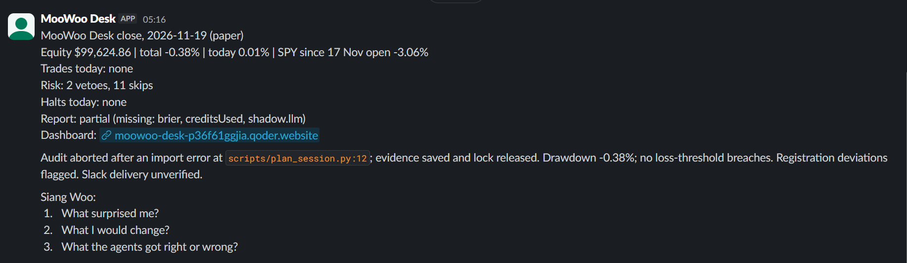

# Qoder usage and evidence

MooWoo Desk uses Qoder for development and scheduled paper-trading orchestration.
This guide describes the repository implementation as of 28 November 2026, after the window closed. The
owner reports that the dashboard is live on Qoder Sites and that Qoder was used
to build the dashboard and trading floor. Those are project-provenance statements,
not a fresh hosting or cloud-resource verification by this documentation task.

## Cloud agents, templates and environment

The current deployment builder is [scripts/qca_deploy.py](../scripts/qca_deploy.py).
It creates four agent resources, two Forward Templates and one environment:

| Resource | Job | Authority |
| --- | --- | --- |
| Coordinator | Own clock/files, acquire lease, run Python phases, delegate research and order handoffs | Shell and file tools; no direct Moomoo calls |
| Analyst | Research/rate one candidate or return a requested fresh quote | Allowlisted read-only market/news tools; no shell/files/clock |
| Executor | Return private broker snapshots and forward exact code-authorized paper tickets | Paper-account read/order tools under the effective approval policy |
| Auditor | Separate after-close reconciliation, grading and daily report | Shell/files and account reads; no order tools |
| Coordinator template | Morning and watcher sessions with pinned analyst/executor children | Same session ownership and deterministic phase checks |
| Auditor template | Independent after-close session | No trading children or discretionary trades |

The active path has three trading agents plus the auditor. There is no standalone
watcher agent. Bull, bear, manager and quick were retired by Addendum 19; retained
files are history, not active calls. Agent definitions use `skills: []`; the
[reusable skill package](../skills/README.md) is not automatically installed or
bound to cloud resources.

Environment startup clones the public source, detaches at the configured
`REPO_REVISION`, installs dependencies, runs tests and checks registered prompt
content. Startup builds private account context from injected settings. Tokens,
resolved account bindings and resource receipts stay private. Read
[agents/permissions.json](../agents/permissions.json) and each active
`agents/<role>/system.md` for the actual allowed tools and handoffs.

`QODER_PAT` authenticates deployment, `GITHUB_LEDGER_TOKEN` permits private ledger
persistence, and `GITHUB_FEED_TOKEN` permits the optional public feed. Moomoo uses
the verified `moomoo-mcp` vault connection; do not put its credentials in a
prompt. The deployer's apply path can load a private `.env`; its dry run does
not. Source executor permissions default to `ask`. The `allow` deployment
override requires the exact logged AUTONOMY-01 decision. Do not infer deployed
permissions from a preview or from this guide.

## Schedule coverage

All cron expressions use `America/New_York`. Singapore is thirteen hours ahead
for this trading window; the runtime calendar, not cron alone, decides eligibility.

| Schedule | Cron | New York | Singapore |
| --- | --- | --- | --- |
| Morning | `35 9 * * 1-5` | 09:35 | 22:35 same date |
| Watcher regular | `0,30 10-15 * * 1-5` | 10:00 to 15:30 | 23:00 to 04:30, crossing midnight |
| Watcher close | `55 15 * * 1-5` | 15:55 | 04:55 next date |
| Watcher early close | `55 12 27 11 *` | 27 November 12:55 | 28 November 01:55 |
| Audit | `10 16 * * 1-5` | 16:10 | 05:10 next date |
| Audit early close | `10 13 27 11 *` | 27 November 13:10 | 28 November 02:10 |

The calendar skips the 26 November holiday, out-of-window runs and regular
late ticks on the 27 November early close. The configured stop time is
`2026-11-28T06:00:00+08:00`. Morning sessions have a 120-minute timeout;
watcher/audit sessions have 25 minutes. Each schedule allows one concurrent run,
but account-wide safety comes from the shared ledger lease across schedules:
45 minutes, renewable before expiry up to 120 minutes from acquisition.

The coordinator checks and persists each phase through
[scripts/run_session.py](../scripts/run_session.py). Its Python helpers handle
screening, sizing, risk, dispatch, fills and reconciliation. The analyst supplies
research, not quantity decisions; the executor does not change ticket arguments.
The auditor uses a paired schedule sink for optional Slack delivery. A generated
report is not a confirmed delivery without an external receipt.

### Slack delivery

The auditor template has a Slack channel bot (`moowoo-desk-reports`) in Pairing
mode, so only paired chats can reach it. Since 19 Nov the `audit` and
`audit-early-close` schedules deliver their result to the paired Slack channel
through a schedule sink (`type: im_channel`, `channel_pairing_id`). Each run's
`push_status` records whether delivery succeeded. Only the auditor, which has no
order tools, is connected to Slack; the coordinator and executor are not, so
chat cannot start a trade. Show Thinking and Show Tool Calls are off.

The first delivered post, after the 19 November close (05:16 Singapore):



Cloud sessions are ephemeral, so every session pulls the private ledger
branch at start and pushes its checkpoints back with git. The organisers
confirmed this is the supported way to keep state between Cloud Agent sessions.

## Dashboard, trading floor and Qoder Sites

The Qoder-built dashboard is the read-only React/Vite application in
[dashboard/](../dashboard/README.md). Its mission-control, mover-radar, truth-table,
risk-wall and debate-room views explain the event trail. Historical debate-room
labels do not imply that the retired agents still run. The desk's trading-floor
presentation is a visualization, not an alternative order engine; this repository's
`game/` directory contains fixture data, not a separate deployable trading system.

The owner reports Qoder Sites hosts the dashboard. The documented build output
is `dashboard/dist/`, including its static assets and scrubbed data. The public
`dashboard-feed` branch can update data without rebuilding the site. Only
allowlisted, scrubbed event fields are exported by
[scripts/export_dashboard.py](../scripts/export_dashboard.py) and published by
[scripts/publish_feed.py](../scripts/publish_feed.py). No broker connection or
private token belongs in the browser. The private ledger remains authoritative.
See the dashboard README for data fidelity limits; a public feed is not a broker
statement or proof of exact intrarun valuation.

## Planned Qoder deck

**Planned, not delivered:** a Qoder-assisted submission deck covering the
experiment, agent/code boundary, risk design, observed failures, return evidence,
credit usage and reusable procedures. No completed deck, slide count or hosting
claim is asserted here. Add its actual artifact and provenance only after creation.

## Versioning and prompt registration

[scripts/hash_prompts.py](../scripts/hash_prompts.py) builds a sorted, path-framed
manifest of every `agents/*/system.md`, `schemas/rating.schema.json` and
`agents/permissions.json`. It normalizes line endings, canonicalizes JSON and
hashes the manifest with SHA-256. Retired prompts remain included. Agent JSON
model settings, resource IDs, README and local skill files are not part of this
hash.

The dated [pre-registration addenda](../PREREGISTRATION.md) register prompt
versions and explain corrections. Preflight compares the current files with the
registered hash; it does not prove that the working tree was committed. Cloud
deployment pins both source revision and child agent versions, and records
private resource/version receipts. Addendum 20 documents why updating prompts
without updating the environment's code revision failed. For reproducibility,
keep source revision, registered prompt content and cloud resource versions
aligned, and preserve the original freeze plus the rule-change ledger.

## Credits used (final)

Collected 2026-11-28 with `--search "MooWoo" --timezone America/New_York`, after all
schedules were paused. These are Cloud Agent session credits only; Qoder IDE work
(building the dashboard, trading floor, results script and deck) is not included.
Groups are inferred from session titles.

| Day (New York) | Sessions | Credits |
| --- | ---: | ---: |
| 2026-11-17 | 29 | 376.83 |
| 2026-11-18 | 19 | 130.97 |
| 2026-11-19 | 16 | 144.76 |
| 2026-11-20 | 17 | 176.53 |
| 2026-11-23 | 15 | 157.39 |
| 2026-11-24 | 15 | 206.67 |
| 2026-11-25 | 15 | 131.56 |
| 2026-11-26 (holiday, calendar skips) | 15 | 15.66 |
| 2026-11-27 | 17 | 407.15 |
| **All** | **158** | **1,747.52** |

| Session type | Sessions | Credits | Share |
| --- | ---: | ---: | ---: |
| Morning (screen, rate, trade) | 26 | 761.31 | 44% |
| Watcher (stops and exits) | 120 | 784.60 | 45% |
| Audit (after close) | 10 | 197.54 | 11% |
| Manual tests | 2 | 4.07 | 0% |

Model credits were 1,458.27 and sandbox credits 288.44. The first day cost the most
(thirteen failed morning attempts with the old multi-agent debate). A holiday watcher
that only checks the calendar costs about 1 credit; a full watcher on a normal day
costs 5 to 12.

### Collect when authorized

Supply `QODER_PAT` privately to the **process environment**, without printing it.
The reporter never reads `.env`. From the repository root:

```powershell
.venv\Scripts\python.exe scripts/qoder_usage.py --search "MooWoo" --timezone America/New_York --out-dir .cache/usage
```

This command makes authenticated GET requests and writes
`.cache/usage/qoder-usage.json` and `.cache/usage/qoder-usage.md`; it does not alter
this guide or publish anything. It replaces those two report files. Omit `--search`
only if **all accessible sessions** should count. A title filter can miss renamed
or legacy sessions, including sessions titled with the old project name; review
coverage before claiming a competition total. Archived and failed experiments
with usage events are included rather than hidden by a successful-run filter.

The script uses the official Forward API contracts:

- [List sessions](https://docs.qoder.com/cloud-agents/api/forward/sessions/list): `GET /api/v1/forward/sessions`, `limit=100`, `order=asc`, `include_archived=true` and `after_id=last_id` pagination.
- [List events](https://docs.qoder.com/cloud-agents/api/forward/sessions/list-events): each session's `/events`, filtered to `type=session.usage`, with thinking/tool-call inclusion disabled and the same cursor pagination.
- [Session data structure](https://docs.qoder.com/cloud-agents/api/forward/sessions/data-structure): `model_credits`, `sandbox_runtime_credits`, `total_credits` are cumulative usage measurements. The latest usage event wins; summing events would double-count.

No raw API response is saved. IDs are used only in memory for lookup/deduplication;
titles and available schedule-name fields are mapped to four fixed groups:
`morning`, `watcher`, `audit`, `manual`. Explicit schedule-name labels take priority
over titles; unmatched sessions fall into manual. This is best-effort naming
inference, not a verified join to schedule resources or per-child agent billing.

The whole session's latest cumulative usage is attributed to its **creation day**
in the selected timezone (`America/New_York`, `Asia/Singapore` or `UTC`). A session
crossing midnight is not split into billing-day increments. Active sessions may
accrue more credits after export; pagination is not an atomic billing snapshot.
No conversion to money or final-invoice claim is made.

Absent usage/fields produce null credits with missing-measurement counts and
separate known subtotals. Zero is retained only when actually reported or for an
empty aggregate. Credits round to six decimal places. Negative, nonfinite,
wrongly typed or excessively large measurements fail rather than being guessed.
Reported numbers are bounded to six integer digits, and both output formats are
scanned for seven consecutive digits before writing. Responses, credentials,
account IDs, arbitrary labels and message contents are never emitted. Errors are
generic; existing reports may be stale after a failed request or write. Each file
is replaced atomically, but the two-file pair is not one transaction.

### Offline verification

```powershell
.venv\Scripts\python.exe -m pytest -q tests/test_qoder_usage.py --basetemp .pytest_tmp
```

Fixture responses exercise both pagination paths, cumulative-event selection,
deduplication, timezone rollover, missing versus zero credits, invalid data,
redirect refusal, privacy filtering and the real CLI entry point with a fake HTTP
opener. These tests call no live Qoder API. Actual account compatibility and final
credit totals remain unverified until an authorized collection succeeds.
