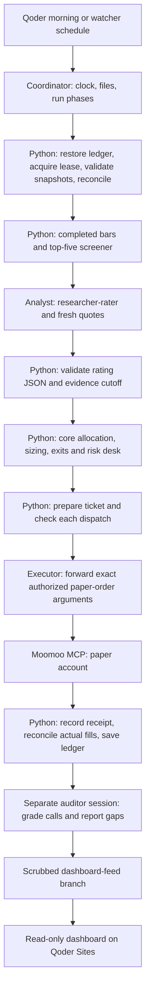

# Durable session runtime

All commands run from the pinned source checkout. Use `python3` in the cloud or
`.venv/Scripts/python` locally. The source checkout and `runtime/` are separate git
repositories. Runtime pushes target only `refs/heads/ledger` of the PRIVATE repo
`xxycoc/MooWoo-Ledger`, because raw receipts and tickets carry the account ID and
this source repo is public. The token needs write
access to that branch; it must not be printed, placed in a remote URL, or written
to a git configuration file. Runtime contains account receipts and is sensitive:
the repository's access policy must be appropriate for those records.

## Detailed session flow



The diagram shows the morning path. Watch sessions manage existing positions
without new rating calls. The auditor has no order tools. Public feed publication
also runs on session completion, independently of whether an audit has produced
a report. Broker acceptance is not a fill; positions change on reconciliation.
Each close ends with a code-written audit summary, and only the auditor (no order
tools) posts it to Slack through a Qoder schedule sink.

The coordinator runs both morning and watcher sessions; watcher is a schedule,
not a fourth trading agent. Bull, bear, manager and quick were retired on
18 November under Addendum 19. Their files remain as experimental history.

## Persistence and ownership

```text
python3 scripts/persist_ledger.py restore --dir runtime/
python3 scripts/persist_ledger.py save --dir runtime/ --message "Session complete" --holder <holder>
```

`GITHUB_LEDGER_TOKEN` comes from the session environment. Git receives an HTTPS
authorization header through `GIT_CONFIG_*` environment entries, with interactive
credential helpers and tracing disabled. Neither command reads `.env`. A missing
remote branch starts an empty ledger; failed authentication does not. The
`--remote` override accepts a local repository for offline tests.

The payload includes logs, state, inputs, immutable ticket manifests, receipts,
grading, hypotheses and audit handoffs. Every `.jsonl` in runtime must be an event
log. Store raw transcripts in `.json` or `.txt`. Verification uses the same
`moowoo.ledger.verify` implementation as `scripts/verify_ledger.py`. Handoff
terminal hash/count pairs must match the preserved prefix of each log. An
unresolved rebase or broken chain blocks saving. Restore refuses dirty runtime
directories. Save uses fetch/rebase/push, with one initial attempt and at most
three retries. A conflict stops with the local repository intact, including the
rebase state; there is no force push or automatic conflict resolution.

`moowoo.runlock.acquire` writes `locks/run.lock`, commits, and pushes before any
agent work. The push is the ownership decision. Acquisition never rebases a lost
race. The lease records holder, kind, start and 45-minute expiry. A stale takeover
adds a `reflection_note`, not a halt. Every runner phase checks remote ownership
and expiry. Checkpoints retain the lock; the final save removes the lock in the
same commit as the final data. A failed save does not release the remote lock.
Lease expiry is not permission for an old executor to continue: finish each
broker call before expiry and recheck before any further calls. Git cannot fence
an already-running external MCP request.

Renew before the current lease expires with:

```text
python3 scripts/run_session.py --kind morning --phase renew --dir runtime
```

Use the acquired kind (`morning`, `watch`, or `audit`). Renewal checkpoints the
lock without releasing it or changing the phase. Expiry becomes 45 minutes from
renewal, capped at 120 minutes from acquisition. Expired or replaced leases are
never renewed. Morning cloud sessions have a 120-minute timeout; watch and audit
remain at 25 minutes. The longer timeout does not renew a lease automatically.

Immediately before each prepared order tool call, run:

```text
python3 scripts/dispatch_check.py --kind morning --decision-id <id> --dir runtime
python3 scripts/dispatch_check.py --kind watch --decision-id <id> --dir runtime
```

Use the matching session kind. A successful check returns `ok`, `decisionId`,
and the exact saved `args`; failure returns `ok: false` and `reason` with a
nonzero exit. It checks remote ownership, the prepared attempt and receipt,
the calendar, and only that ticket's frozen 60-second freshness window. It
neither prepares another attempt nor calls the broker. Successful output carries
the account identifier: forward it privately, never into public logs. A check
cannot fence a delayed external broker call or consume the attempt; receipt
recording and no-repeat executor discipline still apply.

Preserved log identities come from verified events, not filenames. Multiple
files claiming one identity are rejected rather than silently combined. Logs
are never renamed or rewritten to repair an identity mismatch. Empty logs have
no event identity and must be investigated rather than guessed from their names.

## Phase commands and files

Start with one command:

```text
python3 scripts/run_session.py --kind morning --phase start
python3 scripts/run_session.py --kind watch --phase start
python3 scripts/run_session.py --kind audit --phase start
```

Use only the line for that session's kind. `start` restores, acquires the lock,
checks the calendar, and prints runId, input directory, state path and log path.
It defaults to `runtime/`. A skipped start saves its calendar note and unlocks.
Stop on `skipped=true`, a nonzero exit, or an expired lease. There is no order or
agent call inside the Python runner. It executes deterministic scripts around
the agent's explicit phase handoffs. No run fabricates an initial account state:
if the ledger is empty, supply verified `runtime/state.json` from broker snapshots.

Put inputs in the directory returned by start, `runtime/inputs/<runId>/`:

| File | Required use |
| --- | --- |
| `accounts.json` | Executor's exact account-list response for preflight |
| `history.json`, `positions.json`, `cash.json` | Fresh, complete broker snapshots before baseline and final reconciliation |
| `history-pages.json` | Optional map of continuation cursor to exact returned page |
| `quotes.json` | Existing planner/watcher quote contract; aware `now`, sessionDate and timestamped quotes |
| `session.json` | `{"barsAsOf":"YYYY-MM-DD"}` from the completed session |
| `bars.json` | Cached completed daily bars, including required benchmarks |
| `ratings.json` | Morning only: validated primary ratings with this run's decision IDs; no second opinions |
| `responses.json` | Exact executor receipt envelopes; never inferred fills |

Preserve agent transcripts alongside those inputs. Never invent data to satisfy a
missing file. For an auditor, barsAsOf must be the session just closed. Morning
and watcher planning use completed bars from before the current session.

After baseline reconciliation, use `scripts/gather_inputs.py --kind morning|watch
--inputs <returned-input-directory>` for completed bars, session facts and the
morning screen/candidates. First run `python3 scripts/session_info.py` for
barsAsOf, hours and cutoffs; never research the calendar. Morning only: delegate
according to candidates.json and save every child reply verbatim to
`<inputs>/replies/<decisionId>.<role>.json`, then run
`python3 scripts/ingest_ratings.py --inputs <inputs>` for ratings.json.
Quotes come LAST: collect the generated analyst quote request, then run
`scripts/convert_quotes.py --inputs <returned-input-directory>` immediately before
plan. See [the input handoff](handoff-16-inputs.md) for exact commands, raw quote
formats, prompt replacement text and the offline no-order rehearsal.

The watcher also requires preflight: the existing execution gate requires a
matching `run_started` event in each run's log. This is an additional guard beyond
the brief's morning-only preflight, retained rather than bypassing that gate.
PREREGISTRATION.md contains dated promptVersion addenda and AUTONOMY-01.
Preflight requires the latest registered hash to match scripts/hash_prompts.py;
a prompt revision needs its own committed matching addendum before execution.

## Batch rating handoff

After morning gather and child replies, before plan, run:

```text
python3 scripts/ingest_ratings.py --inputs runtime/inputs/<runId>
```

The input directory must be named `<runId>` under `inputs/`. Files are trusted
runtime inputs or verbatim child replies; never rewrite replies to make them pass.

| Path relative to `<inputs>` | Contract |
| --- | --- |
| `session.json` | Required gather output; `runId`, `kind: "morning"`, `barsAsOf` |
| `candidates.json` | Required gather output, array of at most `PICK_COUNT` (5) picked movers in rank order; each has `rank`, `decisionId`, `ticker`, trusted `newsCutoff`, `barsAsOf`, `promptVersion`, `primaryAgent`, `quickSecondOpinionRequired`. The stored candidate `setupScore` is not trusted; ingestion recomputes it. |
| `bars.json` | Required gather output, completed daily OHLCV bars keyed by ticker; each accepted ticker needs bars through `session.barsAsOf` |
| `replies/<decisionId>.analyst.json` | Required for every candidate; original brief with matching identity/cutoff and `items` containing id, headline, source, UTC publishedAt and summary. Empty items are allowed. |
| `replies/<decisionId>.bull.json`, `.bear.json` | Required for ranks 1–5; exact debate objects with `decisionId`, `stance`, `argument` (at most 150 words), `itemIds` referencing eligible brief items |
| `replies/<decisionId>.manager.json` | Required primary for ranks 1–5, `tier: "debate"`, validated against the candidate cutoff and promptVersion |
| `replies/<decisionId>.quick.json` | Required primary for ranks 6–15, `tier: "quick"`. Expected for ranks 1–5 as a separately validated second opinion; missing/invalid quick logs its own skip and cannot reject a valid manager primary. |
| `ratings.json` | Generated atomically; only accepted primaries in picked order, or `[]`. Never hand-write this file. |

`decisionId` is exactly `<runId>:<ticker>`; filenames preserve the colon. These
are ordinary Linux files in the cloud. On Windows/NTFS a colon denotes an alternate
data stream, so use Linux for durable transcript storage/transfer; ordinary Windows
directory listings and copy tools may omit those streams. No filename substitution
or reply-content normalization is performed by ingestion.

The rating object retains `decisionId`, `ticker`, `class`, `confidence`, `tier`,
`reason`, `evidence`, `newsCutoff`, `expectedMove`, `wrongIf`, `model`, and
`promptVersion`, plus validated optional display summaries and the integer
`setupScore` from `setup_score(bars)["total"]`. The JSON array is directly usable
as `scripts/plan_session.py --ratings <inputs>/ratings.json`. No event envelopes,
credits, skip records or second-opinion rows enter this array. Bull/bear summaries
are display metadata; they never overwrite the manager class or confidence.

Ingestion appends through the existing locked `EventLog` at
`<inputs>/../../logs/<runId>.jsonl`. Each decision has one terminal primary outcome
and, for ranks 1–5, one independent second-opinion outcome. Missing/malformed
replies, bad candidate metadata or unusable ticker bars become ticker `halt`
events with `disposition: "skip"`, `stage: "rating_validation"` and the appropriate
`secondOpinion` flag. A partial batch still exits successfully and reports accepted
and skipped primary counts. Invalid run-level files, unsafe/duplicate ticker
identities, corrupt logs or I/O failures fail the command.

The same writer lock spans replay, append and export. Reruns reuse logged outcomes,
including skips, and rebuild the export without duplicate events. An interruption
after one append is recoverable on rerun; a torn/corrupt log fails closed. Do not
edit candidates or retry corrected replies within a terminal decision; retain the
evidence and use a new run. This command is local ingestion only; it does not
acquire a remote lease, save runtime, call agents or authorize execution.

Batch events use `credits: null` and
`creditsMissingReason: "Live child agents expose no cost meter."`; unknown cost
is never represented as zero. The single-rating CLI supports `--credits null
--credits-missing-reason "<reason>"`; measured numeric `--credits` still works.
Null requires a nonempty reason, and measured credits cannot carry a missing
reason. The SQLite decisions projection stores nullable credits and the reason;
rebuild it from the log to update an older disposable projection. The frozen
rating schema and promptVersion inputs are unchanged.
When the single-rating CLI also receives `--quick-output`, that separate event
records unknown quick cost with its own reason; it never duplicates the primary's
measured credits.

Morning and watcher sequence (substitute `watch` for `morning` as appropriate):

```text
python3 scripts/run_session.py --kind morning --phase preflight
python3 scripts/run_session.py --kind morning --phase reconcile
python3 scripts/run_session.py --kind morning --phase plan
python3 scripts/run_session.py --kind morning --phase prepare
python3 scripts/run_session.py --kind morning --phase record
python3 scripts/run_session.py --kind morning --phase reconcile
python3 scripts/run_session.py --kind morning --phase finish
```

Collect account snapshots before preflight. The first reconcile establishes the
baseline. Perform the morning screening/classifier work after preflight and
baseline, before plan; a watcher performs no classification. Plan calls
`plan_session.py` for morning or `watch.py` for watcher. Only after prepare succeeds
and its checkpoint push succeeds, run
`python3 scripts/dispatch_check.py --kind K --decision-id <id>` for EACH ticket.
Only ok:true authorizes handing its exact args to executor for one order.
Prepare blocks every order during the first five minutes and
rejects tickets older than the frozen freshness limit. It rechecks the calendar,
lease and ticket freshness after the push, before returning order arguments.
Record the executor's exact receipt envelopes first, then refresh history
(all pages), positions and cash before final reconciliation. Even an empty prepared
batch needs `responses.json=[]` and record before final reconciliation. Cancellation
instructions returned by reconciliation are not executed by Python; preserve and
report unresolved cancellations, and never treat an audit as authority to cancel.

Auditor sequence, in its own Session:

```text
python3 scripts/run_session.py --kind audit --phase reconcile
python3 scripts/run_session.py --kind audit --phase grade_calls
python3 scripts/run_session.py --kind audit --phase score_hypotheses
python3 scripts/run_session.py --kind audit --phase finish
```

Audit reconciliation reads all original manifests/logs and routes fill events to
the original decision's run log. Each grading/scoring phase checkpoints its
output. Finish requires both phases, writes a hash/count handoff, saves and unlocks. No audit
phase can plan or prepare orders. Hypothesis output is
`runtime/hypotheses/latest.json`; grading events are in `runtime/logs/*-grading.jsonl`.

On an agent failure, use the same kind with `--phase abort`; this saves all
available evidence and releases ownership only if the save succeeds. CLI data
errors attempt this automatically. Persistence/ownership failures retain the
local copy and require inspection. Do not resume trading after such a failure.
The runner never silently repeats a prepared order. State-machine transitions
are local control data in ignored `.session.json`; durable evidence lives in the
remote ledger and must be reconciled by a new run after container loss.

Coordinator alone writes files, runs phase commands and checks `date -u` before
each command/external call. Executor returns exact broker payloads; analyst
returns research or requested quotes; classifiers return JSON. Children neither
write files nor verify time. Optional evidence gaps are logged; absent cost
telemetry is unavailable (`credits: null`), never zero. AUTONOMY-01 plus deployed
always_allow authorizes paper execution after a passing dispatch_check handoff;
never bypass an effective approval gate. Receipts use placed with decisionId,
integer attempt, exact args and decoded untouched response, or rejected, failed,
timeout or approval_expired with a reason. Acceptance is not a fill.

When under 10 minutes of lease remain and work remains, run
`python3 scripts/run_session.py --kind K --phase renew` before continuing.
Use the returned expiry only after success; total lease cap is 120 minutes.
Never continue past expiry or extend market hours or quote/ticket freshness.

## Calendar and deployment conflicts

Trading sessions are 17–20 and 23–25 November, 09:30–16:00 New York, plus
27 November, 09:30–13:00. Thanksgiving, weekends and dates outside the competition
are closed. The close boundary itself is not an order window. Risk uses the
calendar for the first-five-minute and final-day entry gates; supplied market
open/close fields cannot extend the calendar. Record/reconcile/save are still
allowed to retain receipts when an already-started run crosses the close.

Audit starts are accepted from actual close +10 minutes until close +45 minutes.
This separates after-close reporting from regular-hours order eligibility.

The morning cron is **09:35 New York (22:35 SGT)**, one single session after the
first-five-minutes rule. The originally requested 21:30 SGT is 08:30 New York,
premarket, which the regular-hours guard would always skip; the time was moved on
17 November 2026 before any session ran. Screening uses completed prior-day bars,
so nothing is lost by running after the open.

The watcher uses three cron schedules: every half hour 10:00-15:30, 15:55 New
York, and 12:55 on 27 November before its 13:00 early close. The morning run
covers the open; a watcher that meets its lock exits. The calendar skips
Thanksgiving and ticks at/after actual close.
The audit has a 16:10 weekday schedule plus a 13:10 27-November schedule; the
calendar rejects the late 16:10 duplicate on 27 November. Every schedule has
`max_concurrent_runs=1` and `stop_at=2026-11-28T06:00:00+08:00`; the global lock
serializes different schedules. A lock-busy session exits without agent work.

Dry-run command:

```text
python3 scripts/qca_deploy.py --stage schedules --executor-approval allow --approval-log config/rule-ledger.jsonl
python3 scripts/qca_deploy.py --stage executor --executor-approval allow --approval-log config/rule-ledger.jsonl
```

The exact AUTONOMY-01 rule is checked independently of the frozen fee addendum;
it does not alter strategy configuration or source permissions. Apply, when
separately authorized, reads `QODER_PAT` and `GITHUB_LEDGER_TOKEN` from local
`.env`, resolves only outgoing payloads, and never prints either secret. Do not
put tokens in the nonsecret settings JSON. Dry run reads neither secret nor
`.env`. Missing SLACK_CHANNEL_PAIRING_ID produces empty audit sinks and a warning.
The proposed schedule environment_variables and stop_at fields have not been
validated against the live Qoder API. Effective secret delivery, scheduling and
Slack delivery remain deployment integration checks, not offline test results.
The executor stage is an isolated dry-run view; it cannot apply changes.

## Offline verification, 17 November 2026

The interrupted build already supplied persistence, leases, calendar guards,
phase orchestration, cross-run reconciliation, the autonomy rule and schedule
payloads. This completion adds post-persistence freshness/calendar checks,
post-fetch lease-clock checks, separate grading/scoring phases, UTC timestamp
normalization, portable handoff paths and the executor-only dry-run view.

`.venv/Scripts/python -m pytest -q`: **387 passed in 152.34s**. The original
interrupted tree passed 379 tests. Checks use real local bare Git repositories
and actual deterministic CLI subprocesses. Morning/watch empty-order pipelines
use synthetic preregistration at the preflight boundary; separate real-preflight
tests prove that the current missing addendum refuses orders. Audit reconciliation,
grading, scoring, save and restore execute their real commands with synthetic
broker inputs. No live model, broker, GitHub or Qoder behavior was verified.

Exact credential-free command output is saved in
[runtime-schedules.dry-run.json](runtime-schedules.dry-run.json) and
[runtime-executor.dry-run.json](runtime-executor.dry-run.json). Both report
`approvalDecisionVerified: true`. No prompts, frozen values, schemas, permissions
file or evaluation files were changed. No deployment, push, merge or .env creation
was performed.

## Exact proposed prompt wording

Replace the existing direct-CLI orchestration paragraphs with these additions;
retain all existing trading, evidence, permission and reflection rules. Do not
append contradictory old instructions to the new sequence.

### Coordinator

> Run all deterministic phases through `python3 scripts/run_session.py --kind morning`
> from `/data/workspace/MooWoo-Desk`. First call `--phase start`. If it reports
> skipped, fails, or the returned 45-minute lease expires, stop without orders.
> Use the returned runId, log and input directory. Ask executor for exact account,
> complete order history, positions and cash responses; preserve them as described
> in docs/runtime.md. Require verified runtime/state.json, never invent balances.
> Call `--phase preflight`, then `--phase reconcile`. Only after both succeed,
> perform the existing screening, debate and rating-ingestion workflow. Preserve
> transcripts and write only validated primary calls to ratings.json. Supply fresh
> quotes, completed bars and session.json, then call `--phase plan` and
> `--phase prepare`. Forward only the exact returned arguments to executor after
> prepare succeeds; a failed checkpoint push authorizes no order. Never submit in
> the first five regular-market minutes, after close, after lease expiry, or from
> stale tickets. Save executor receipts as responses.json, call `--phase record`,
> refresh broker snapshots, call `--phase reconcile`, then `--phase finish`.
> Preserve and report unresolved cancellations. On any agent failure call
> `--phase abort`; if persistence fails, retain the local copy and stop. Auditor
> remains a separate Session. If start reports skipped (closed day or outside
> regular hours), do not override that result or wait under the lease.

### Watcher mode in coordinator

> For a watcher schedule use `python3 scripts/run_session.py --kind watch` for
> every phase. Call `--phase start`; stop if skipped, failed or lease-expired.
> Collect fresh account/history/positions/cash inputs, then call `--phase preflight`
> and `--phase reconcile`. Supply fresh quotes, completed bars and session.json;
> call `--phase plan` then `--phase prepare`. This invokes only the deterministic
> exit watcher: do not rerun classification or create entry ratings. Executor may
> forward only the returned exact arguments after a successful durable prepare.
> Preserve receipts, call `--phase record`, refresh broker snapshots, call
> `--phase reconcile`, then `--phase finish`. Use `--phase abort` on failure.
> Never continue outside the calendar, during the first-five-minute order block,
> after lease expiry, or after a failed persistence operation.

### Auditor

> In this new independent Session run `python3 scripts/run_session.py --kind audit
> --phase start` from `/data/workspace/MooWoo-Desk`. Stop if skipped, failed or
> lease-expired. Restore and inspect the verified handoffs, original manifests,
> transcripts and receipts; the runner verifies event chains and terminal
> hash/count prefixes. Obtain fresh complete order history, positions and cash
> responses into the returned input directory. Call `--phase reconcile`, inspect
> differences and unresolved cancellation instructions, and never execute orders
> or delegate to executor. Supply completed bars through the actual session close
> and session.json. Write the existing daily report and reflection prompts under
> the returned input directory, then call `--phase grade_calls`, followed by
> `--phase score_hypotheses`, then `--phase finish` to write the handoff, save and
> unlock. Read the resulting hypothesis
> output for the final response; distinguish missing data from zero. Use
> `--phase abort` on failure; a failed save is not successful persistence. Return
> the report and the existing three reflection prompts. When no Slack sink is
> configured, state that delivery is disabled; never claim a delivery receipt.

## Input validation and quote refresh (build/23)

Use `scripts/check_broker_input.py --kind accounts|cash|positions|history --file
<path> --stdin` with a quoted heredoc for each reply. It trims fields using
broker_fields, saves atomically, validates immediately and names missing fields.
There are at most two re-fetch/re-save retries after the initial failure. Saved
history pages are assembled with `--assemble <inputs>`. No direct broker transport
was added: the cloud tool result is not exposed to these scripts as a supported
file or stream. The agent still copies the minimal response, without inventing
fields. Preserve original tool transcripts separately.

Malformed or missing broker inputs create a run-scoped input-validation halt,
abort that run and leave PortfolioState.halted unchanged. Genuine reconciliation
or routing disagreements keep their existing persistent halt behavior. This does
not clear any prior halt. A successful next scheduled run uses new validated files.

Prepare the per-ticket save/check command before fetching the quote. On
retryable:true, fetch one fresh quote and repeat it immediately; quoteAttempt is
separate from order attempt. A future timestamp, bad spread, changed marketable
limit, or other refusal is not retryable. If persistence consumes the quote
window, the checker durably records that it withheld authorization before a
refresh. Never retry a returned ok:true authorization. The source limit stays 60 s.

## Close audit collection and partial reporting

After audit reconcile, run `python3 scripts/gather_audit_inputs.py --inputs <inputs>`.
It derives held, pending, traded and rated symbols from verified state/events, adds
SPY and all five core ETFs, fetches completed OHLCV through the actual session
close with the existing yfinance adapter, trims to date/open/high/low/close/volume,
and writes and validates bars.json and session.json in one command. It uses no
new broker credentials or permissions. Missing symbols are saved in
`audit-input-report.json`; an empty valid bars object still permits a partial
report. `--check` revalidates the saved files. Never use partial intraday bars.

The normal grading/scoring phases remain mandatory. Finish writes report.json and
report.md, and saves daily snapshots under runtime/reports. Abort also attempts a
partial report and logs the specific reason. Partial metrics are reflection_note
payloads plus the existing report-only audit halt, not forged daily_report events.
No audit evidence gap sets PortfolioState.halted. Brier requires matured forecasts;
shadow comparisons require validated matched book records and remain unavailable
when these records do not exist. Unknown measured cost is null. Account ratios use
contiguous session-close equity observations only, with no interpolation across
missing audits. The SPY daily-open comparison is explicitly a proxy, not the exact
pre-registered first-eligible-entry baseline. Exact baseline anchors, full frozen
universe coverage, and paired metric intervals remain listed as missing when absent.

## Conditional core rebalance and schedule receipts

CORE-REBALANCE-01 sizes core buys on a temporary projection after approved core
sells. Actual saved cash and holdings are unchanged. CORE-REBALANCE-02 allows
buys before sell fills when existing cash covers all reserved buys and fees while preserving
the 10% cash floor and 30% core limit. Otherwise, CORE_REBALANCE_AFTER_FILLS
retains the requirement for all core sell tickets to be fully filled and
reconciled; projected proceeds cannot fund buys. Before core buys, refresh
broker snapshots and
run `reconcile --continue-orders` through run_session. Dispatch verifies the fill
checkpoints, reserved buys, actual marked core exposure, cash floor, daily loss
and account tier. The target remains 30%; no credit is given to unfilled sells.
Tickets keep their original prices and quantities. Failed dependencies skip buys
only when actual cash or core room cannot cover them.

In America/New_York, recreate `schedule.watcher-close` with `55 15 * * 1-5`.
Also create `schedule.watcher-early-close` with `55 12 27 11 *` for 27 November.
The late ordinary close tick is skipped that day. Both keep the existing stop_at
and cross-schedule lease. The 12:55 run has only five minutes for new orders;
record/reconcile/save may continue after close, but order authorization may not.

### Final session: 27 November 2026

FINAL-CLOSE-01 prohibits all BUYs for the entire session. Morning and watch
manifests list open BUY decision IDs for cancellation; never dispatch them.
Use the existing baseline/reconciliation cancellation requests and record exact
broker replies before releasing reservations. Save exact cancellation receipt
envelopes to the run input `cancel-responses.json` (only `sim_trade_cancel_order`),
refresh broker snapshots, and repeat the reconcile phase. The runner passes these
to `reconcile.py --cancel-responses`, which records them in the original decision
logs before reconciling fills; repeated baseline reconciliation preserves the
baseline phase. Failed cancellations keep their reservations. From 12:00 New York every sleeve
is liquidated via the normal SELL preparation and per-ticket dispatch check.
The scheduled 12:00, 12:30 and 12:55 ticks retry reconciled remaining holdings,
net of pending sells. A partial fill is not a full close: cancel its unfilled
remainder through reconciliation before a new run can reserve those shares.
The session closes at 13:00; no orders are allowed at or after that time.
Only realised results count. Final limits are 1% below bid, rounded down to cents;
dispatch requires a fresh bid at least as high as the fixed limit. Fills are not
guaranteed; report any residual holdings explicitly. Daily-loss and drawdown
halts allow final-liquidation SELLs, while unrelated safety halts remain binding.

TICKER-CAP-01 shrinks or drops BUYs so held shares, pending buys and the new order
at its limit price never exceed USD 40,000 per ticker. This applies to core, SPY
and satellites; pending sells do not release cap room before reconciliation.

The coordinator prompt changed. Recompute `scripts/hash_prompts.py` and register
the matching prompt addendum before deployment; this implementation does not
change PREREGISTRATION.md or authorize deployment.
